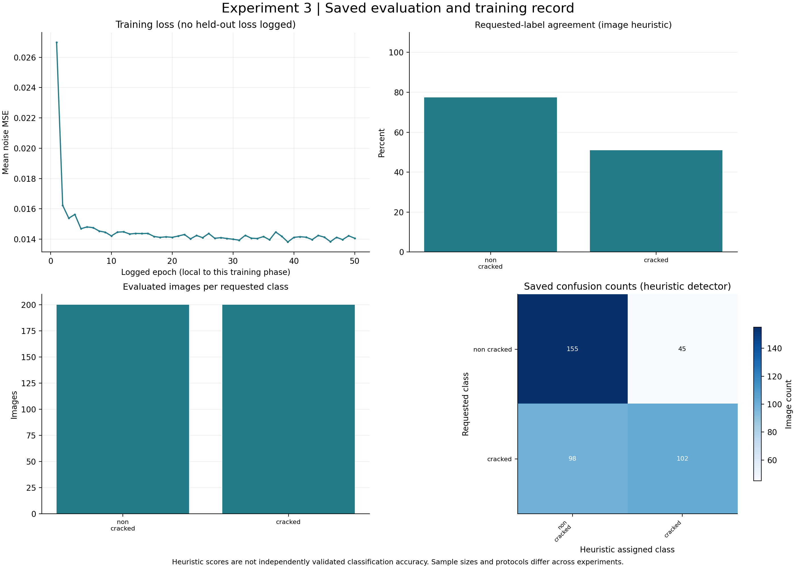
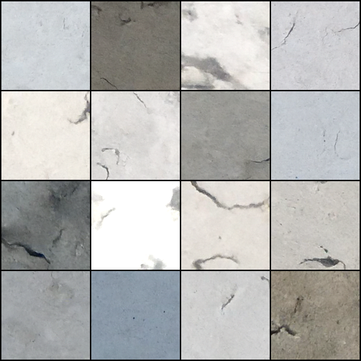
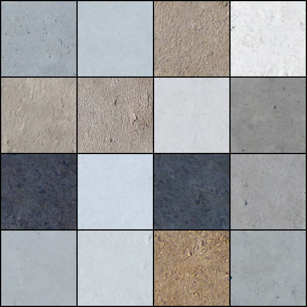

# Experiment 3 Research Report

## Higher resolution binary conditioning with RC data augmentation

Revision: 2026-11-22. Study type: retrospective computational experiment. Historical checkpoint and saved evaluation; prospective validation is identified separately.

## Abstract

Experiment 3 combines a 128-pixel conditional DDPM with a cracked-image subset labeled RC_10519, producing a historical training manifest of 61,001 images. Fifty logged epochs end at noise MSE 0.014058. The later saved evaluation contains 400 images, evenly divided between requested classes, with 64.25% overall heuristic agreement and 51.00% agreement for cracked requests. Resolution, training composition and sampling protocol change together, so the result is not an isolated estimate of a resolution benefit. The earlier closed-experiment statement that no metrics existed is superseded by this later descriptive evaluation.

## 1. Aim and research question

What output behavior is observed after increasing resolution and adding the RC cracked subset to binary conditional training?

Greater spatial sampling and additional cracked examples may retain finer visible detail. This historical experiment changes both factors together and cannot identify their separate causal effects.

## 2. Technical stack and model specification

| Item | Specification and provenance |
| --- | --- |
| Image shape | 128 by 128 RGB |
| Denoiser | SmallUNet |
| Checkpoint tensor parameters | 3,258,627 |
| Image / conditioning channels | 3 RGB + class embedding |
| Requested categories | 2 |
| Completed logged epochs | 50 |
| Final logged noise MSE | 0.014057592 |
| Minimum logged training MSE | 0.013812782 at local epoch 39 |
| Learning rate | 0.0002 (trainer source default; optimizer not saved) |
| Batch size provenance | Trainer default 8; historical command-line arguments not fully captured |
| Software | Python, PyTorch, torchvision, NumPy, Pillow, SciPy; Matplotlib and metric dependencies for evaluation |
| Optimizer | AdamW; beta values 0.9 and 0.999; weight decay 0.01 (saved optimizer where available, otherwise source defaults) |
| Gradient norm clipping | 1.0 in trainer source |
| Precision policy | Current historical trainer enables CUDA autocast and GradScaler; exact historical execution precision is not independently logged |
| Class dropout | Not used in the binary/unconditional source trainers |
| Sampling | 1,000-step ancestral DDPM for the shared pretrained reproduction path |
| Checkpoint selection | Released phase-final checkpoint; no independently held-out selection record |
| Augmentation | Image normalization; external data addition in Exp3, not a verified geometric augmentation benefit |

Epoch numbering in checkpoints is zero-based for Experiments 1–3 and one-based for the later phases; the training log is used to establish the completed phase length. A low training loss is not evidence of held-out generalization. Exact historical CUDA/PyTorch versions, CLI arguments and original peak resource measurements are not fully captured, so later environment checks are not substituted for historical runtime provenance.

## 3. Dataset composition and provenance

| Historical source | Training-manifest records |
| --- | --- |
| SDNET2018 | 50,482 |
| RC_10519 | 10,519 |

| Historical label | Records |
| --- | --- |
| non_cracked | 42,846 |
| cracked | 18,155 |

Total historical training records: **61,001**. Source: [train.csv](../../datasets/exp3_augmented_128/train.csv). These are processed patches, not counts of independent structures or photographs. Labels for the morphology/mechanism-inspired experiments are derived by image-geometry rules. The historical train/reference design and transfer ancestry do not establish independent holdout performance. Source image identities, alias grouping and current qualified manifests are discussed in Section 10.

Dataset references: SDNET2018 [R6]; matching RC collection record [R9].

## 4. Mathematical and implementation basis

For normalized image $x_0$, the implemented forward process uses $T=1000$ and a linear variance schedule from $10^{-4}$ to $0.02$. With $\alpha_t=1-\beta_t$ and $\bar{\alpha}_t=\prod_{s=1}^{t}\alpha_s$:

$$x_t=\sqrt{\bar{\alpha}_t}x_0+\sqrt{1-\bar{\alpha}_t}\epsilon,\qquad \epsilon\sim\mathcal{N}(0,I).$$

The denoiser minimizes noise-prediction mean squared error (the expression suppresses constant normalization by the number of image elements):

$$\mathcal{L}=\mathbb{E}_{x_0,t,\epsilon}\left[\lVert\epsilon-\epsilon_\theta(x_t,t,c)\rVert_2^2\right].$$

The condition $c$ is omitted for the unconditional model. This objective is implemented in the diffusion and training modules and follows the DDPM formulation [R1]. Training MSE is an optimization diagnostic, not a perceptual, topology or physical-validity score.

## 5. Experimental procedure

1. Combine 50,482 SDNET training records with 10,519 local RC images assigned to the cracked class. Preserve source paths and annotation availability.

2. Resize RGB images to 128 by 128, use the binary embedding and inverse-frequency sampler, and train for 50 logged epochs.

3. Preserve the earlier stopped-generation record as historical context; use the later completed collection of 200 non-cracked and 200 cracked requests for this report.

4. Analyse all 400 outputs using the 128-pixel heuristic, and calculate the separately scoped 160-image feature diagnostic from the saved evaluation protocol.

These steps reconstruct the procedure supported by saved artifacts and current source. Defaults are distinguished from observed checkpoint/log values; a missing historical execution configuration is not silently reconstructed as a verified run command.

## 6. Evaluation protocol and statistical interpretation

The primary morphology source is `src/evaluate_exp1_2_3_errors.py`. At 128 pixels it applies local-background subtraction with window 17, darkness threshold 15.0, minimum component area 12 pixels and nominal span threshold 22 pixels. The 128-pixel path additionally applies a 2 by 2 opening. Component counts, image-axis orientation and local contrast are detector outputs, not physical measurements.

The later fidelity diagnostic uses torchvision Inception-v3 with its classifier removed, 299-pixel resizing and ImageNet normalization. It selects training-manifest references: 160 real and 160 generated images for the stored score. KID uses 100 subsets of up to 128 feature vectors and a cubic polynomial kernel. This custom feature/preprocessing protocol is not interchangeable with a standard torch-fidelity run or the earlier torchmetrics feature-64 scores. The KID standard deviation describes subset variability, not a confidence interval over independent training runs.

Wilson 95% intervals summarize binomial counting uncertainty conditional on the saved generator and heuristic. They do not include training-seed variability, detector bias, source clustering or uncertainty about real mechanisms. Precision, recall and F1 computed against requested conditions quantify heuristic correspondence, not human-labeled classification accuracy. Pixel distances are in image coordinates; no physical millimetre scale is available.

For $k$ accepted outputs among $n$ requests, $\hat p=k/n$ and $z=1.95996$. The Wilson interval is

$$\frac{\hat p+z^2/(2n)\ \pm\ z\sqrt{\hat p(1-\hat p)/n+z^2/(4n^2)}}{1+z^2/n}.$$

For saved count matrix $A$, $A_{ij}$ counts request $i$ assigned heuristic class $j$. Row agreement is $A_{ii}/\sum_j A_{ij}$; proxy precision is $A_{ii}/\sum_j A_{ji}$; $F_1=2PR/(P+R)$, with zero used for undefined zero-denominator cases. These definitions explain the table without changing the meaning of requested labels into ground truth.

## 7. Results

Overall requested-label agreement: **257 / 400 (64.25%)**. The following intervals are calculated from the saved counts; precision and F1 also use these counts rather than rounded JSON rates.

| Requested class | Diagonal / requested | Agreement | Wilson 95% interval | Proxy precision | Proxy F1 |
| --- | --- | --- | --- | --- | --- |
| non_cracked | 155 / 200 | 77.50% | 71.23–82.74% | 61.26% | 0.6843 |
| cracked | 102 / 200 | 51.00% | 44.12–57.84% | 69.39% | 0.5879 |

Confusion counts, with requested classes in rows and heuristic-assigned classes in columns:

| Requested / assigned | non_cracked | cracked |
| --- | --- | --- |
| non_cracked | 155 | 45 |
| cracked | 98 | 102 |

### Protocol-qualified feature diagnostic

| Saved metric | Value |
| --- | --- |
| frechet_inception_distance | 94.114 |
| kernel_inception_distance_mean | 0.03294 |
| kernel_inception_distance_std | 0.00188 |
| evaluated_fake_samples | 160 |
| evaluated_real_samples | 160 |

FID and KID summarize feature distributions [R4, R5]; they do not certify crack presence or physical validity. Reference exposure, sample count, feature extraction and image preprocessing are part of the metric definition. Do not rank this value against experiments using another implementation or a different reference distribution.


### Saved plots and generated examples



Figure interpretation: phase-local training loss, detector-defined rates and saved sample counts. This figure is a descriptive summary, not a controlled leaderboard or an independently labeled accuracy assessment.

### Archived illustrative outputs

The following saved illustrations retain their available filenames and request labels. Their membership in the quantified collection is not assumed without an original sampling manifest. They are not a blinded quality study, and their labels are not independent human judgments. The quantitative tables retain the complete stated evaluation denominators.



Cracked samples. Source illustration: `exp3_cracked.png`.



Non-cracked samples. Source illustration: `exp3_noncracked.png`.

## 8. Observations and discussion

The saved matrix contains 155 agreements among 200 non-cracked requests and 102 among 200 cracked requests. Although these rates differ from Experiment 2, the detector window, thresholds, span criteria, image resolution, data composition and generated sample budget differ. The results support a descriptive observation, not a controlled claim that doubling resolution improved crack fidelity. Adding a named source also does not establish source independence: later content and perceptual audits link apparent aliases across collections.

This experiment changes several design factors relative to other phases. Resolution, training images, label taxonomy, transfer ancestry, color processing, sampler and evaluator may differ. A before/after visual comparison is therefore hypothesis-generating; no causal attribution to a single architectural or conditioning change is made.

## 9. Assumptions and their consequences

| Assumption | Implementation or rationale | Consequence and validation status |
| --- | --- | --- |
| Augmentation source | All local RC images are treated as cracked. | All local JSON files contain crack-labeled rectangles, but independent image-level correctness remains unverified. |
| Higher resolution | 128-pixel sampling can retain more visible detail. | Pixel count is not a measurement of physical crack width or improved continuity. |
| Dataset independence | A different source name supplies independent examples. | Contradicted as a general rule by later cross-source alias candidates; v5 grouping addresses the declared similarity screen. |
| Historical status | The stopped early run describes the final experiment state. | Superseded by the later 400-image analysis; earlier status records remain archived. |

All image-derived labels assume that visible dark geometry is informative about the intended visual attribute. Real masks, bounding boxes and class labels answer different annotation questions. Additional annotations or a mechanics-inspired name do not independently verify a failure mechanism.

## 10. Completed audits and prospective validation

The prospective **research_v5** manifests contain the following base partition counts. They were constructed after the historical training and do not retroactively make its checkpoints unseen-data models.

| Partition | Base records |
| --- | --- |
| train | 48,088 |
| validation | 6,898 |
| test | 6,015 |

The shared source audit covers 67,264 originals, with 65,866 distinct decoded RGB images and 1,398 extra exact decoded copies. The v4 perceptual screen found 386 cross-split candidates. V5 conservatively links all 1,111 candidate pairs, including within-split pairs, before assignment; the same pHash ≤3 and dHash ≤6 search then finds zero cross-split candidates. This limited, uncalibrated screen can miss crops, rotations, flips and larger edits. Source names and zero screened matches do not prove site or structure independence.

RC attribution identifies a matching Mendeley record [R9] and its requested paper [R10]. Local ZIP sizes/CRCs match extracted files, but no publisher digest established local archive identity. All 10,519 local JSON files contain crack rectangles; these boxes do not validate image-level labels, pixel masks or structural mechanisms. The geometry audit flags 1,145 source annotations, including 1,122 out-of-bounds cases and 150 image/annotation dimension mismatches; categories overlap.


Scratch training, EMA selection on fixed-noise validation, provenance-checked generation and geometry/fidelity preflight are implemented for the new lineage. Their bounded smoke runs are infrastructure checks. Full clean multi-seed training, independently labeled generated images, external validation and downstream detector utility have not been established by the historical artifacts. A prepared campaign is not a completed experiment.

Computational sharing was tested in a fresh Windows/Python 3.10 CPU environment: the public weights were downloaded and verified and one image per experiment was generated without raw datasets. This confirms that inference can execute under that environment; it does not reproduce model training or validate image quality.

## 11. Sources of error and errors identified

| Identified issue | Correction or interpretation |
| --- | --- |
| No metrics claimed after a later evaluation existed | Report the 400-image analysis and its dates/status separately from the earlier closure. |
| RC described as independently new data without qualification | Matching publisher attribution is available; payload identity and acquisition independence are not fully verified. |
| Improvement attributed solely to resolution | Resolution, composition and detector protocol are confounded. |

Further threats include segmentation sensitivity to texture and illumination; source overlap and patch clustering; heuristic circularity between curation and evaluation; small or unequal sample budgets; image-derived versus procedurally generated conditioning; reference preprocessing differences; and incomplete historical execution metadata. No structural safety, real crack width, downstream detection benefit, state-of-the-art performance or physical-cause accuracy is claimed from these measurements.

## 12. Conclusion

Experiment 3 provides a higher-resolution, augmented-data conditional checkpoint and a later 400-image descriptive evaluation. It motivates native-resolution morphology work, but it does not isolate the effect of resolution or establish independent external-dataset generalization.

## 13. Reproducibility and artifact record

The released historical weights are used for inference; these commands do not start training. Run from the repository root with the documented dependencies and a fresh output directory.

```powershell
.\.venv\Scripts\python.exe pipeline/download_models.py
.\.venv\Scripts\python.exe pipeline/checkpoints.py verify
.\.venv\Scripts\python.exe pipeline/generate_cracks.py --experiment 3 --crack-type cracked --count 1 --seed 2026 --output-dir experiments/conditional_ddpm_128_augmented/report_replication_seed2026
```

A fixed seed requires matching checkpoints, sampling settings, device and software for comparable execution; it does not guarantee cross-device pixel identity or exact replication of a historical example grid. Research training uses a separate scratch lineage and must not overwrite these final weights.

| Evidence | Artifact |
| --- | --- |
| Primary metric record | [EVALUATION_METRICS.json](../../experiments/conditional_ddpm_128_augmented/EVALUATION_METRICS.json) |
| Training log | [conditional_128_augmented_training_loss.csv](../../experiments/conditional_ddpm_128_augmented/logs/conditional_128_augmented_training_loss.csv) |
| Checkpoint SHA256 | f6c3e5ffd855e53cb5a9e2b6f77db5630d96db27dd6b0a37e26555f127f41252 |
| Input hashes and revision archive | [report_evidence.json](../../experiments/conditional_ddpm_128_augmented/report_evidence.json) |
| Training source | [train_conditional_128_augmented.py](../../src/train_conditional_128_augmented.py) |
| Evaluation source | [evaluate_exp1_2_3_errors.py](../../src/evaluate_exp1_2_3_errors.py) |

Code is available in the [project repository](https://github.com/AlgoRubic/Crack-Image-Generation). The six historical checkpoints are distributed in the [versioned model release](https://github.com/AlgoRubic/Crack-Image-Generation/releases/tag/historical-models-v1), with a checksum manifest. Raw datasets are not included in that inference bundle. Dataset references identify their publishers, while local source inventories record observed archive hashes and outstanding identity/annotation limitations.


The machine-readable evidence file records input SHA256 values, checkpoint metadata, log handling and exact archived pre-revision sources. The historical reports remain recoverable and are superseded where their claims conflict with the corrected tables above. Original sampling files do not provide a complete checkpoint-hash chain for every historical evaluation image; association with the released phase checkpoint follows the available procedural record. No new generation, training or rerun of image-evaluation algorithms is implied by this revision. Counts, Wilson intervals and derived matrix statistics are calculated from saved artifacts.

## 14. References

[R1] Ho, Jain and Abbeel (2020). Denoising Diffusion Probabilistic Models. [Source](https://arxiv.org/abs/2006.11239)

[R4] Heusel et al. (2017). FID proposal in GANs Trained by a Two Time-Scale Update Rule Converge to a Local Nash Equilibrium. [Source](https://arxiv.org/abs/1706.08500)

[R5] Bińkowski et al. (2018). Demystifying MMD GANs; KID proposal. [Source](https://arxiv.org/abs/1801.01401)

[R6] SDNET2018 dataset and acquisition documentation. [Source](https://digitalcommons.usu.edu/all_datasets/48/)

[R9] Wang (2026). Reinforced concrete structure crack detection dataset 10519, Mendeley Data v1. DOI 10.17632/3ghxck2wd5.1. [Source](https://data.mendeley.com/datasets/3ghxck2wd5/1)

[R10] Wang et al. (2024). Automatic detection of building surface cracks using UAV and deep learning-combined approach. Structural Concrete 25(4), 2302–2322. [Source](https://doi.org/10.1002/suco.202300937)
