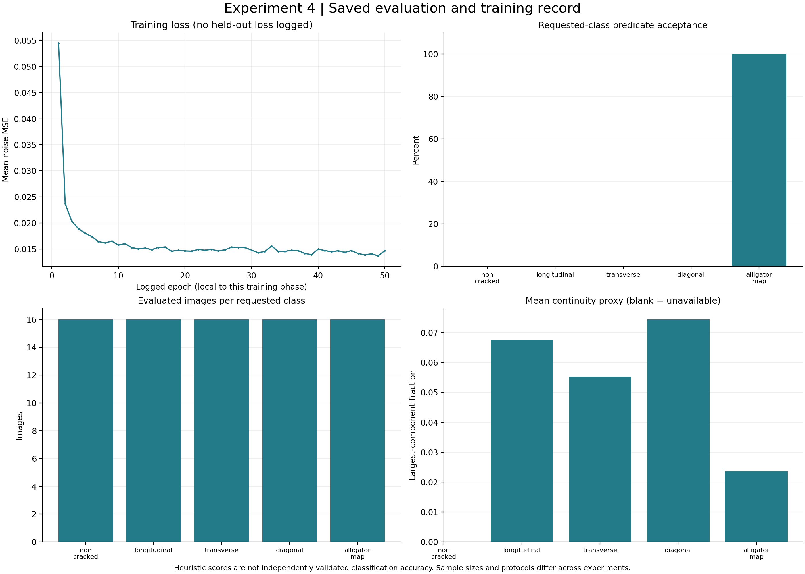
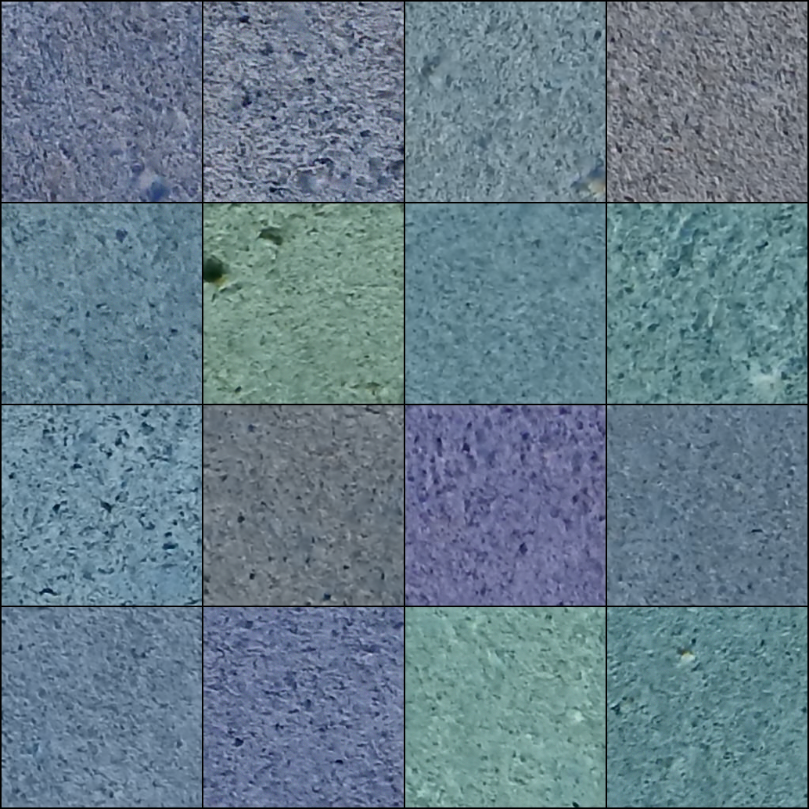
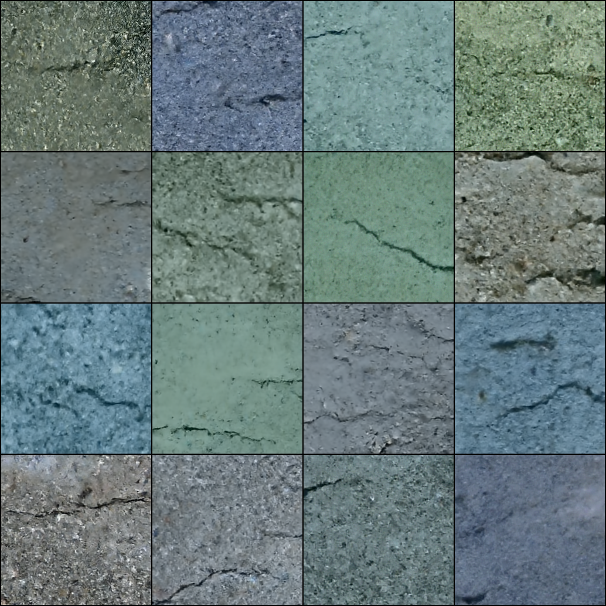
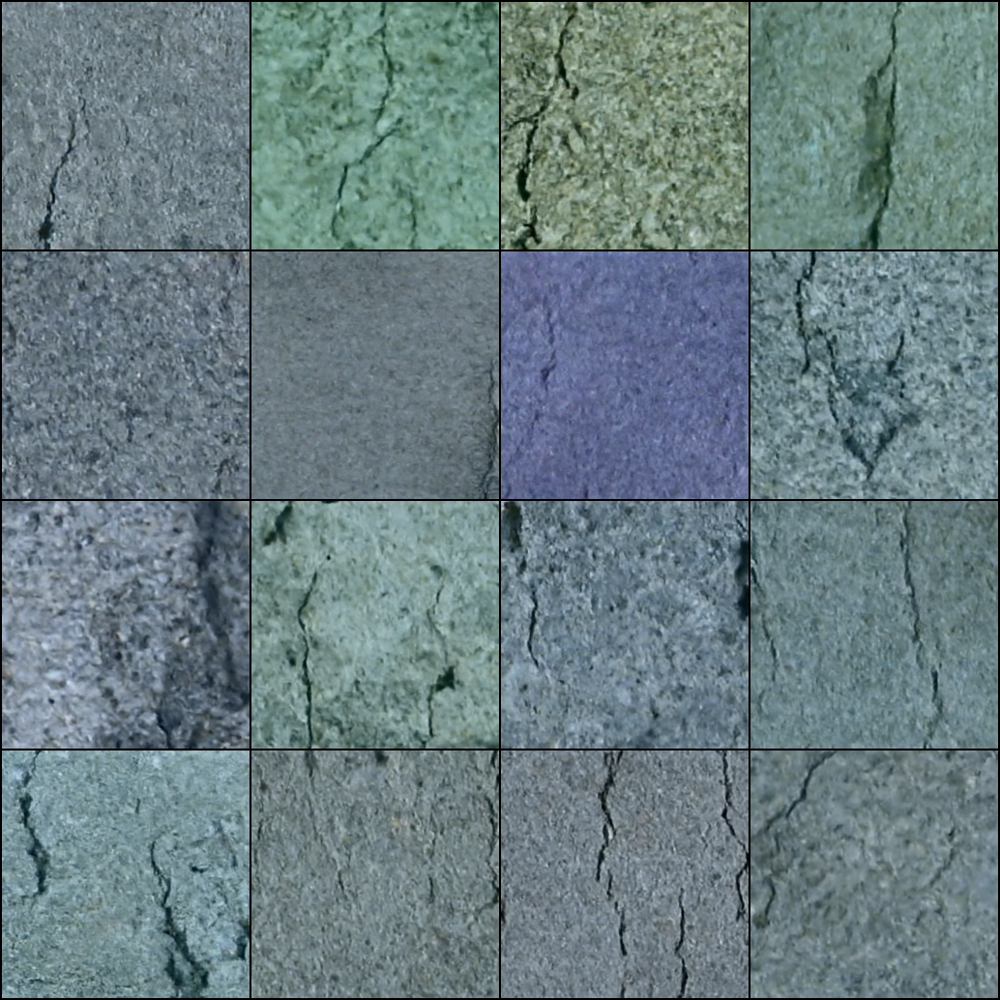
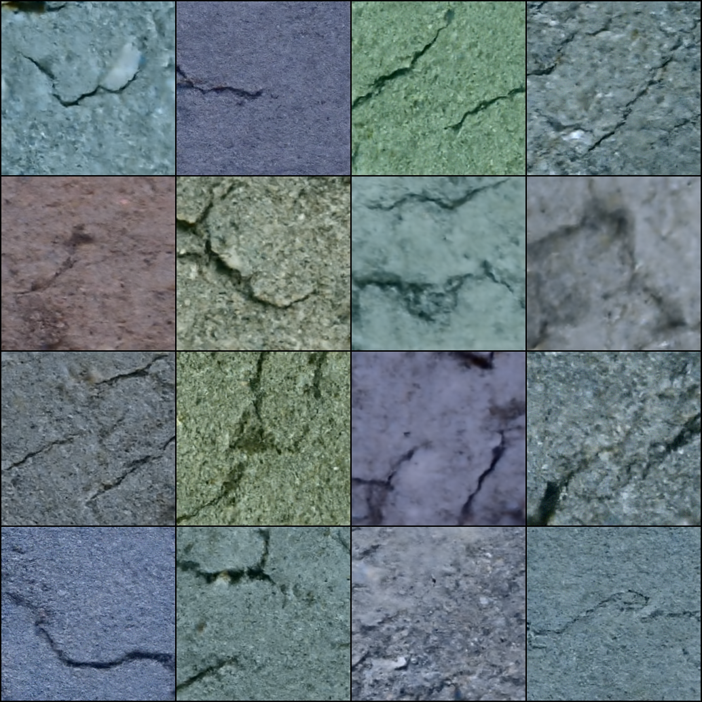
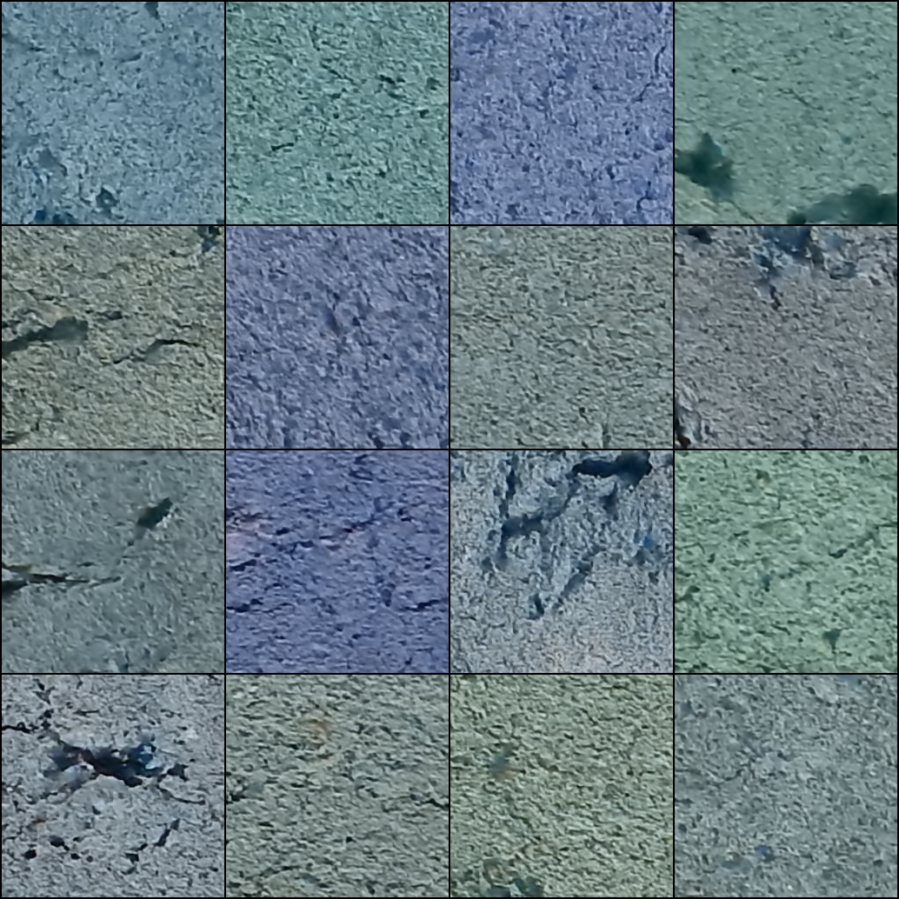

# Experiment 4 Research Report

## Five class morphology conditioning at 256 by 256 pixels

Revision: 2026-11-22. Study type: retrospective computational experiment. Historical checkpoint and saved evaluation; prospective validation is identified separately.

## Abstract

A 13,820,003-parameter attention U-Net is trained at 256-pixel resolution with five morphology-derived class labels. The historical manifest contains 13,139 patches from SDNET2018 and DeepCrack. Fifty logged epochs end at noise MSE 0.014690. The 80-image heuristic evaluation reports zero clean-surface agreement for non-cracked requests and zero orientation alignment for longitudinal, transverse and diagonal requests. Its map predicate accepts all 16 map requests. These results do not support the earlier statement that fragmentation was resolved, and their interpretation depends strongly on detector behavior.

## 1. Aim and research question

Can native 256-pixel synthesis with attention and morphology labels produce outputs that satisfy class-specific image-geometry predicates?

Higher-resolution images and nonlocal feature interactions may help represent extended structures. The hypothesis must be tested with validated topology measurements and controlled ablations; architecture choice alone is not evidence of continuity.

## 2. Technical stack and model specification

| Item | Specification and provenance |
| --- | --- |
| Image shape | 256 by 256 RGB |
| Denoiser | AttentionUNet256 |
| Checkpoint tensor parameters | 13,820,003 |
| Image / conditioning channels | 3 RGB + class embedding |
| Requested categories | 5 |
| Completed logged epochs | 50 |
| Final logged noise MSE | 0.014690474 |
| Minimum logged training MSE | 0.013714464 at local epoch 49 |
| Learning rate | 0.00015 (checkpoint optimizer) |
| Batch size provenance | Trainer default 6; historical command-line arguments not fully captured |
| Software | Python, PyTorch, torchvision, NumPy, Pillow, SciPy; Matplotlib and metric dependencies for evaluation |
| Optimizer | AdamW; beta values 0.9 and 0.999; weight decay 0.01 (saved optimizer where available, otherwise source defaults) |
| Gradient norm clipping | 1.0 in trainer source |
| Precision policy | Current historical trainer enables CUDA autocast and GradScaler; exact historical execution precision is not independently logged |
| Class dropout | 0.10 in Exp4 source |
| Sampling | Historical 50-step DDIM-style CFG, reported guidance 2.5 |
| Checkpoint selection | Released phase-final checkpoint; no independently held-out selection record |
| Augmentation | Horizontal and vertical flips in Exp4 source |

The parameter count is verified from the saved state dictionary. Attention is implemented through scaled-dot-product attention; the selected backend depends on runtime and hardware, so calling the implementation FlashAttention does not prove that a particular kernel executed. Historical environment/CLI provenance is incomplete. Phase-local epochs and training loss are not a controlled comparison with other experiments.

## 3. Dataset composition and provenance

| Historical source | Training-manifest records |
| --- | --- |
| DeepCrack | 2,066 |
| SDNET2018 | 11,073 |

| Historical label | Records |
| --- | --- |
| longitudinal | 978 |
| diagonal | 686 |
| alligator_map | 5,140 |
| transverse | 335 |
| non_cracked | 6,000 |

Total historical training records: **13,139**. Source: [train.csv](../../datasets/exp4_level_a_morphology_256/train.csv). These are processed patches, not counts of independent structures or photographs. Labels for the morphology/mechanism-inspired experiments are derived by image-geometry rules. The historical train/reference design and transfer ancestry do not establish independent holdout performance. Source image identities, alias grouping and current qualified manifests are discussed in Section 10.

Dataset references: SDNET2018 [R6]; DeepCrack [R7]; matching RC collection record [R9].

## 4. Mathematical and implementation basis

For normalized image $x_0$, the implemented forward process uses $T=1000$ and a linear variance schedule from $10^{-4}$ to $0.02$. With $\alpha_t=1-\beta_t$ and $\bar{\alpha}_t=\prod_{s=1}^{t}\alpha_s$:

$$x_t=\sqrt{\bar{\alpha}_t}x_0+\sqrt{1-\bar{\alpha}_t}\epsilon,\qquad \epsilon\sim\mathcal{N}(0,I).$$

The denoiser minimizes noise-prediction mean squared error (the expression suppresses constant normalization by the number of image elements):

$$\mathcal{L}=\mathbb{E}_{x_0,t,\epsilon}\left[\lVert\epsilon-\epsilon_\theta(x_t,t,c)\rVert_2^2\right].$$

The condition $c$ is omitted for the unconditional model. This objective is implemented in the diffusion and training modules and follows the DDPM formulation [R1]. Training MSE is an optimization diagnostic, not a perceptual, topology or physical-validity score.

The historical fast sampler uses a 50-step deterministic DDIM-style update [R2]. At the reported guidance scale $w=2.5$, it combines conditional and null predictions as

$$\hat{\epsilon}=\epsilon_{\mathrm{null}}+w\left(\epsilon_{\mathrm{cond}}-\epsilon_{\mathrm{null}}\right).$$

Classifier-free guidance [R3] changes the sampling trade-off. Finite steps, clipping, image transforms and device-dependent arithmetic preclude claiming exact invertibility or universal bitwise reproducibility. The historical sampler's implementation should be retained when reproducing historical artifacts; the prospective sampler is a separately documented protocol.

## 5. Experimental procedure

1. Prepare native 256-pixel patches using source crack masks and image-label curation. The actual manifest contains DeepCrack and SDNET records; CrackForest is not present in this Exp4 manifest.

2. Assign five image-geometry classes and balance their exposure during training. Use horizontal and vertical flips in the historical trainer.

3. Train the attention U-Net for 50 logged epochs. The current historical trainer sets class-drop probability 0.10; the earlier 0.15 report statement is inconsistent with that source.

4. Sample the saved 16-image collection per class with the historical 50-step DDIM/CFG path and evaluate the class-specific morphology rules.

These steps reconstruct the procedure supported by saved artifacts and current source. Defaults are distinguished from observed checkpoint/log values; a missing historical execution configuration is not silently reconstructed as a verified run command.

## 6. Evaluation protocol and statistical interpretation

The morphology evaluator subtracts a 15-pixel local grayscale mean and thresholds at 16 intensity units. Components, their bounding-box diagonal, principal orientation and component concentration determine the predicates. The five groups contain 16 saved images each. A map-rule success can be triggered by dispersed components rather than a verified crack network. The separate FID/KID artifact uses 80 generated and 80 reference images; no independently held-out evaluation lineage is established for that historical number.
Wilson 95% intervals summarize binomial counting uncertainty conditional on the saved generator and heuristic. They do not include training-seed variability, detector bias, source clustering or uncertainty about real mechanisms. Precision, recall and F1 computed against requested conditions quantify heuristic correspondence, not human-labeled classification accuracy. Pixel distances are in image coordinates; no physical millimetre scale is available.

For $k$ accepted outputs among $n$ requests, $\hat p=k/n$ and $z=1.95996$. The Wilson interval is

$$\frac{\hat p+z^2/(2n)\ \pm\ z\sqrt{\hat p(1-\hat p)/n+z^2/(4n^2)}}{1+z^2/n}.$$

## 7. Results

| Requested class | Images | Accepted count | Predicate acceptance | Wilson 95% interval | Continuity proxy |
| --- | --- | --- | --- | --- | --- |
| non_cracked | 16 | 0 / 16 | 0.00% | 0.00–19.36% | Not reported |
| longitudinal | 16 | 0 / 16 | 0.00% | 0.00–19.36% | 0.0676 |
| transverse | 16 | 0 / 16 | 0.00% | 0.00–19.36% | 0.0553 |
| diagonal | 16 | 0 / 16 | 0.00% | 0.00–19.36% | 0.0744 |
| alligator_map | 16 | 16 / 16 | 100.00% | 80.64–100.00% | 0.0236 |

Counts are arithmetic reconstructions from the saved rates and denominators. These class-specific predicates are not an independently assigned multiclass confusion matrix.

### Protocol-qualified feature diagnostic

| Saved metric | Value |
| --- | --- |
| frechet_inception_distance | 167.6 |
| kernel_inception_distance_mean | 0.04526 |
| kernel_inception_distance_std | 0.01413 |
| sample_count | 80 |
| reference_count | 80 |

FID and KID summarize feature distributions [R4, R5]; they do not certify crack presence or physical validity. Reference exposure, sample count, feature extraction and image preprocessing are part of the metric definition. Do not rank this value against experiments using another implementation or a different reference distribution.


### Saved plots and generated examples



Figure interpretation: phase-local training loss, detector-defined rates and saved sample counts. This figure is a descriptive summary, not a controlled leaderboard or an independently labeled accuracy assessment.

### Archived illustrative outputs

The following saved illustrations retain their available filenames and request labels. Their membership in the quantified collection is not assumed without an original sampling manifest. They are not a blinded quality study, and their labels are not independent human judgments. The quantitative tables retain the complete stated evaluation denominators.



Non-cracked. Source illustration: `exp4_non_cracked_256_grid.png`.



Longitudinal. Source illustration: `exp4_longitudinal_256_grid.png`.



Transverse. Source illustration: `exp4_transverse_256_grid.png`.



Diagonal. Source illustration: `exp4_diagonal_256_grid.png`.



Alligator map. Source illustration: `exp4_alligator_map_256_grid.png`.

## 8. Observations and discussion

The recorded linear continuity ratios are 0.0676, 0.0553 and 0.0744, with approximately 79, 84 and 70 significant components for the three linear classes. Calling this resolved fragmentation contradicts the recorded proxy measurements. The map rule accepts a dispersed set of components; a 100% acceptance rate can therefore be compatible with over-segmented texture. Detector calibration and a prospective paired architecture comparison are needed to distinguish generator limitations from evaluator failure.

This experiment changes several design factors relative to other phases. Resolution, training images, label taxonomy, transfer ancestry, color processing, sampler and evaluator may differ. A before/after visual comparison is therefore hypothesis-generating; no causal attribution to a single architectural or conditioning change is made.

## 9. Assumptions and their consequences

| Assumption | Implementation or rationale | Consequence and validation status |
| --- | --- | --- |
| Morphology labels | Orientation and component structure summarize the intended classes. | These are image-geometry labels, not independently verified structural failure causes. |
| Native patches | 256-pixel processing preserves source detail. | Resolution alone does not preserve topology, and crops may remove structural context. |
| Flip invariance | Horizontal/vertical flips preserve Exp4 morphology labels. | Suitable only for geometry categories; they do not preserve a known beam tension-zone frame. |
| Attention | Long-range feature interactions should improve continuity. | Design rationale, not demonstrated causal benefit in this historical comparison. |
| Map detection | Many components with a dispersed mask indicate map cracking. | Texture fragmentation can also satisfy the rule. |

All image-derived labels assume that visible dark geometry is informative about the intended visual attribute. Real masks, bounding boxes and class labels answer different annotation questions. Additional annotations or a mechanics-inspired name do not independently verify a failure mechanism.

## 10. Completed audits and prospective validation

The prospective **research_v5** manifests contain the following base partition counts. They were constructed after the historical training and do not retroactively make its checkpoints unseen-data models.

| Partition | Base records |
| --- | --- |
| train | 10,325 |
| validation | 1,537 |
| test | 1,277 |

The shared source audit covers 67,264 originals, with 65,866 distinct decoded RGB images and 1,398 extra exact decoded copies. The v4 perceptual screen found 386 cross-split candidates. V5 conservatively links all 1,111 candidate pairs, including within-split pairs, before assignment; the same pHash ≤3 and dHash ≤6 search then finds zero cross-split candidates. This limited, uncalibrated screen can miss crops, rotations, flips and larger edits. Source names and zero screened matches do not prove site or structure independence.

RC attribution identifies a matching Mendeley record [R9] and its requested paper [R10]. Local ZIP sizes/CRCs match extracted files, but no publisher digest established local archive identity. All 10,519 local JSON files contain crack rectangles; these boxes do not validate image-level labels, pixel masks or structural mechanisms. The geometry audit flags 1,145 source annotations, including 1,122 out-of-bounds cases and 150 image/annotation dimension mismatches; categories overlap.


Scratch training, EMA selection on fixed-noise validation, provenance-checked generation and geometry/fidelity preflight are implemented for the new lineage. Their bounded smoke runs are infrastructure checks. Full clean multi-seed training, independently labeled generated images, external validation and downstream detector utility have not been established by the historical artifacts. A prepared campaign is not a completed experiment.

Computational sharing was tested in a fresh Windows/Python 3.10 CPU environment: the public weights were downloaded and verified and one image per experiment was generated without raw datasets. This confirms that inference can execute under that environment; it does not reproduce model training or validate image quality.

## 11. Sources of error and errors identified

| Identified issue | Correction or interpretation |
| --- | --- |
| Fragmentation labeled resolved despite low continuity fractions | Replace the claim with the observed measurements and evaluator uncertainty. |
| CrackForest listed in the Exp4 training set | The manifest source counts contain SDNET2018 and DeepCrack only. |
| Class dropout reported as 15% | The source trainer uses 10%; historical CLI/runtime provenance remains incomplete. |
| DDIM described as guaranteeing invertibility | Finite clipped sampling does not establish exact inverse reconstruction or cross-device bit identity. |

Further threats include segmentation sensitivity to texture and illumination; source overlap and patch clustering; heuristic circularity between curation and evaluation; small or unequal sample budgets; image-derived versus procedurally generated conditioning; reference preprocessing differences; and incomplete historical execution metadata. No structural safety, real crack width, downstream detection benefit, state-of-the-art performance or physical-cause accuracy is claimed from these measurements.

## 12. Conclusion

Experiment 4 implements native-resolution attention and five-class geometry conditioning. Its saved evaluation does not demonstrate resolved fragmentation or reliable linear-class control. It establishes an architectural and taxonomy step whose benefits require a new, matched and independently evaluated comparison.

## 13. Reproducibility and artifact record

The released historical weights are used for inference; these commands do not start training. Run from the repository root with the documented dependencies and a fresh output directory.

```powershell
.\.venv\Scripts\python.exe pipeline/download_models.py
.\.venv\Scripts\python.exe pipeline/checkpoints.py verify
.\.venv\Scripts\python.exe pipeline/generate_cracks.py --experiment 4 --crack-type all --count 1 --seed 2026 --output-dir experiments/crack_type_conditional/report_replication_seed2026
```

A fixed seed requires matching checkpoints, sampling settings, device and software for comparable execution; it does not guarantee cross-device pixel identity or exact replication of a historical example grid. Research training uses a separate scratch lineage and must not overwrite these final weights.

| Evidence | Artifact |
| --- | --- |
| Primary metric record | [EVALUATION_METRICS.json](../../experiments/crack_type_conditional/EVALUATION_METRICS.json) |
| Training log | [training_loss.csv](../../experiments/crack_type_conditional/logs/training_loss.csv) |
| Checkpoint SHA256 | a5983d5eac819b3dcfdb3537f7fcf5bb5b16716eaf5f72ee3ebb8bd31d4b52e6 |
| Input hashes and revision archive | [report_evidence.json](../../experiments/crack_type_conditional/report_evidence.json) |
| Training source | [train_crack_type_256.py](../../src/train_crack_type_256.py) |
| Evaluation source | [evaluate_crack_type_256.py](../../src/evaluate_crack_type_256.py) |

Code is available in the [project repository](https://github.com/AlgoRubic/Crack-Image-Generation). The six historical checkpoints are distributed in the [versioned model release](https://github.com/AlgoRubic/Crack-Image-Generation/releases/tag/historical-models-v1), with a checksum manifest. Raw datasets are not included in that inference bundle. Dataset references identify their publishers, while local source inventories record observed archive hashes and outstanding identity/annotation limitations.


The machine-readable evidence file records input SHA256 values, checkpoint metadata, log handling and exact archived pre-revision sources. The historical reports remain recoverable and are superseded where their claims conflict with the corrected tables above. Original sampling files do not provide a complete checkpoint-hash chain for every historical evaluation image; association with the released phase checkpoint follows the available procedural record. Counts, Wilson intervals and derived matrix statistics are calculated from saved artifacts.

### Verified saved-image reproduction

On 22 November 2026, the morphology/spatial analysis was rerun on all saved evaluation images for this experiment in two fresh directories (`saved-analysis-20261122-v2` and `saved-analysis-20261122-v3`). All 27 compared numeric baseline fields matched with absolute tolerance 0.0001 and zero relative tolerance; the two fresh metric JSON records were identical in the same local environment. Per-image row counts, input/output SHA256 values and preservation of the original metrics were verified. Across all six experiments, each run analysed 4,992 images. Fidelity and the manually authored Exp4 comparison block were explicitly excluded, so this does not reproduce historical FID/KID, establish independent accuracy, or execute new sampling or training.

```powershell
.\.venv\Scripts\python.exe pipeline/reproduce_results.py --run-id my-exp4-review --experiments 4
```

The command refuses existing run folders and fails on missing historical inputs. Raw evaluation images and physics masks are retained locally and excluded from ordinary Git; Exp1–3 also require their recorded processed-image reference subset. A Git clone alone is sufficient for report evidence verification and published-weight inference, but does not contain every saved-image input. Read the [reproduction guide](../../docs/REPRODUCIBILITY.md) and [folder map](../../docs/PROJECT_STRUCTURE.md).

| Verified reproduction | Record |
| --- | --- |
| Summary | [saved_analysis_reproduction.json](../../experiments/saved_analysis_reproduction.json) |
| saved-analysis-20261122-v2 | [run_manifest.json](../../experiments/crack_type_conditional/reproductions/saved-analysis-20261122-v2/run_manifest.json) |
| saved-analysis-20261122-v3 | [run_manifest.json](../../experiments/crack_type_conditional/reproductions/saved-analysis-20261122-v3/run_manifest.json) |
## 14. References

[R1] Ho, Jain and Abbeel (2020). Denoising Diffusion Probabilistic Models. [Source](https://arxiv.org/abs/2006.11239)

[R2] Song, Meng and Ermon (2020; ICLR 2021). Denoising Diffusion Implicit Models. [Source](https://arxiv.org/abs/2010.02502)

[R3] Ho and Salimans (2022). Classifier-Free Diffusion Guidance. [Source](https://arxiv.org/abs/2207.12598)

[R4] Heusel et al. (2017). FID proposal in GANs Trained by a Two Time-Scale Update Rule Converge to a Local Nash Equilibrium. [Source](https://arxiv.org/abs/1706.08500)

[R5] Bińkowski et al. (2018). Demystifying MMD GANs; KID proposal. [Source](https://arxiv.org/abs/1801.01401)

[R6] SDNET2018 dataset and acquisition documentation. [Source](https://digitalcommons.usu.edu/all_datasets/48/)

[R7] DeepCrack source repository, masks and dataset splits. [Source](https://github.com/yhlleo/DeepCrack)

[R9] Wang (2026). Reinforced concrete structure crack detection dataset 10519, Mendeley Data v1. DOI 10.17632/3ghxck2wd5.1. [Source](https://data.mendeley.com/datasets/3ghxck2wd5/1)

[R10] Wang et al. (2024). Automatic detection of building surface cracks using UAV and deep learning-combined approach. Structural Concrete 25(4), 2302–2322. [Source](https://doi.org/10.1002/suco.202300937)
