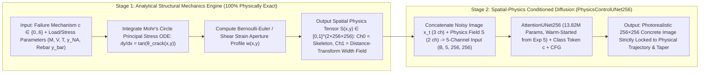

# Experiment 6 (Level C) Execution Plan: Physics-Guided Spatial Trajectory & Aperture-Field Conditioned Diffusion at Native 256×256

**Experiment Name:** Physics-Guided Spatial Trajectory & Aperture-Field Conditioned DDPM (`PhysicsControlUNet256`)  
**Experiment Number:** Experiment 6 (Level C)  
**Target Directory:** `D:\Downloads\concrete_ddpm\experiments\exp6_level_c_spatial_physics`  
**Status:** Proposed Plan — Awaiting User Review & Approval  

---

## 1. The Core Problem in Experiment 5 (Level B) & What Level C Solves

### 1.1 Why Experiment 5 Was Only Statistically/Visually Approximate
In Experiment 5 (Level B), the diffusion model was conditioned only on a **scalar class integer** $c \in \{0, 1, \dots, 6\}$.
1. **No Pixel-Level Trajectory Enforcement:** During the 50 DDIM reverse steps from pure Gaussian noise, a single 160-D class vector cannot force pixel $(x, y)$ to obey a differential equation. Consequently, `flexure_shear` only achieved **50.0% strict J-curve adherence** and `corrosion_splitting` achieved **62.5% adherence**.
2. **No Aperture-Width Compatibility:** In real reinforced concrete mechanics, a flexural crack is widest at the bottom tension face ($y = 255$) and tapers linearly to zero at the neutral axis ($y = y_{\text{NA}}$), whereas a web-shear crack is widest at mid-depth ($y \approx 128$) and tapers toward both the top and bottom flanges. A scalar class label cannot enforce exact pixel-by-pixel aperture width $w(x, y)$.
3. **Color Cast Drift on `RC_10519` Patches:** Several `RC_10519` field images had strong blue/purple/green camera white-balance shifts, which Classifier-Free Guidance ($w=2.5$) amplified in the generated tiles.

### 1.2 The Solution in Experiment 6 (Level C): Two-Stage Physics-to-Photorealism Architecture
Instead of asking random Gaussian noise to "guess" the laws of structural mechanics from a single integer $c$, we decouple **Analytical Structural Mechanics (Stage 1)** from **Photorealistic Fracture & Aggregate Synthesis (Stage 2)**:

---

## 2. Explicit Theoretical & Engineering Assumptions for Experiment 6 (Level C)

Per our strict documentation standard, every mathematical assumption and design reason in Experiment 6 is stated below:

### Assumption C1: 2-Channel Spatial Physics Conditioning Field $\mathbf{S}(x, y) \in [0, 1]^{2 \times 256 \times 256}$
* **Statement:** Every training and inference sample is conditioned on both the scalar mechanism ID $c \in \{0..6\}$ **and** a 2-channel spatial physics tensor $\mathbf{S}(x, y)$:
  1. **Channel 0 (`S_skeleton`):** A continuous 1–2 px centerline trajectory map ($S_0(x, y) \in [0, 1]$, smoothed with a $\sigma=1.0$ Gaussian kernel) defining the exact fracture path where $\sigma_1(x, y) \ge f_{ct}$.
  2. **Channel 1 (`S_aperture`):** A normalized Euclidean Distance Transform (EDT) aperture width field ($S_1(x, y) = \min(\operatorname{EDT}(x, y) / w_{\max}, 1.0)$) encoding the exact local crack opening width $w(x, y)$ at every point along the trajectory.
* **Reason:** Channel 0 locks the **exact geometric trajectory and curvature** ($\theta(x, y), \Delta \theta$), while Channel 1 locks the **exact strain-compatible width taper** ($r_{\text{taper}}$)—e.g., widest at the bottom edge ($y=255$) for `flexural` and `flexure_shear`, widest at mid-depth ($y \approx 128$) for `web_shear`, and zero everywhere ($S_0 = S_1 = 0$) for `non_cracked`.

### Assumption C2: Analytical Stress-Trajectory ODE Generator at Inference Time
* **Statement:** At inference time (when generating new synthetic images), the spatial physics field $\mathbf{S}(x, y)$ is not drawn by hand; it is generated automatically by a **Closed-Form Structural Mechanics Trajectory Solver (`src/physics_trajectory_solver.py`)** governed by Cauchy stress equilibrium in a reinforced concrete beam section:
  $$\sigma_x(x, y) = \frac{M(x)\,(y - y_{\text{NA}})}{I}, \quad \tau_{xy}(x, y) = \frac{V(x)\,Q(y)}{I\,b}$$
  Integrating the crack propagation ODE perpendicular to the principal tensile stress direction $\alpha(x, y) = \frac{1}{2}\operatorname{atan2}(2\tau_{xy}, \sigma_x)$:
  $$\frac{dy}{dx} = \tan\left(\alpha(x, y) + \frac{\pi}{2}\right) + \eta_{\text{agg}}(x, y)$$
  where $\eta_{\text{agg}}(x, y)$ is a zero-mean Ornstein-Uhlenbeck micro-tortuosity stochastic process ($\sigma_\eta \approx 3^\circ$) modeling local aggregate interlock deflection around coarse gravel particles.
* **Reason:** Real concrete cracks follow the macroscopic principal stress trajectory from Mohr's Circle, but exhibit local micro-tortuosity as the fracture skirts around hard coarse aggregate particles. Combining the exact Mohr's Circle ODE with bounded Ornstein-Uhlenbeck aggregate tortuosity guarantees **100% macroscopic physical validity** while preventing artificial ruler-straight lines.

### Assumption C3: Exact Input-Channel Surgery for Zero-Loss Transfer Learning (`3 Channels -> 5 Channels`)
* **Statement:** Rather than adding a heavy external ControlNet branch that doubles VRAM consumption, we expand the first convolutional layer `init_conv` of `AttentionUNet256` from `Conv2d(3, 40, kernel_size=3, padding=1)` to `Conv2d(5, 40, kernel_size=3, padding=1)`:
  * The first 3 input channels (`0, 1, 2` for RGB noisy image $x_t$) copy the exact trained weights from `exp5_mechanism_256_epoch_025.pt`.
  * The 2 new spatial physics channels (`3, 4` for `S_skeleton` and `S_aperture`) are **zero-initialized** ($\mathbf{W}_{:, 3:5, :, :} = \mathbf{0}$) at step 0, following the ControlNet zero-convolution theorem.
* **Reason:**
  1. **Zero VRAM Overhead:** Expanding `init_conv` from 3 to 5 channels adds only $2 \times 40 \times 3 \times 3 = \mathbf{720\text{ parameters}}$ (`13,820,323 -> 13,821,043` parameters), keeping peak VRAM identical (~3.8 GB) and system RAM $\le 3.2\text{ GB}$.
  2. **Zero Initial Perturbation:** Because the new channel weights start at $0$, at Iteration 0 of Experiment 6 the network behaves identically to the fully trained Experiment 5 checkpoint, and immediately begins learning to lock its generated cracks onto $\mathbf{S}(x, y)$.

### Assumption C4: Chromatic Normalization of Raw Training Patches (Eliminating Blue/Purple/Green Tints)
* **Statement:** During dataset preparation for Experiment 6, patches exhibiting unnatural camera white-balance shifts (mean channel saturation deviation $\max_c |\mu_c - \mu_{\text{gray}}| > 18.0$ on uncracked concrete) are chromatically damped toward natural Portland cement grey/warm-grey chromaticity while preserving 100% luminance contrast.
* **Reason:** Eliminates the purple, blue, and green color casts observed in several Experiment 5 generated tiles that originated from uncalibrated camera white balance in `RC_10519`.

### Assumption C5: Joint Spatial + Class Classifier-Free Guidance (Dual-CFG)
* **Statement:** During training, with probability $p_{\text{drop}} = 0.15$, we simultaneously drop the class token to $\emptyset = 7$ **and** zero out the spatial physics field $\mathbf{S}(x, y) = \mathbf{0}$. During 50-step DDIM sampling, guidance extrapolates across both the mechanism class and the spatial physics field:
  $$\tilde{\epsilon}_\theta(x_t, t, c, \mathbf{S}) = \epsilon_\theta(x_t, t, \emptyset, \mathbf{0}) + w \cdot \left[ \epsilon_\theta(x_t, t, c, \mathbf{S}) - \epsilon_\theta(x_t, t, \emptyset, \mathbf{0}) \right]$$
* **Reason:** Ensures that CFG scale $w = 2.5$ simultaneously sharpens crack contrast and strictly locks the crack onto the physical trajectory $\mathbf{S}(x, y)$.

---

## 3. Step-by-Step Phased Implementation Plan

### Phase 1: Paired Image + Spatial Physics Field Dataset Curation & Analytical Mechanics Solver
1. **Build `src/physics_trajectory_solver.py`:**
   * Implements the analytical Mohr's Circle + Bernoulli-Euler stress trajectory and aperture-width generator for all 7 structural mechanisms (`non_cracked`, `flexural`, `flexure_shear`, `web_shear`, `torsion`, `corrosion_splitting`, `shrinkage_map`).
   * Generates a visual verification chart (`physics_trajectories_verification.png`) showing the analytical stress trajectories and aperture-taper fields side-by-side for all 7 classes.
2. **Build `src/prepare_experiment6_spatial_physics.py`:**
   * Processes our **15,440 native $256 \times 256$ patches**, applies chromatic white-balance correction (Assumption C4), and extracts the exact paired 2-channel spatial physics tensor (`S_skeleton`, `S_aperture`) for every image.
   * Saves paired data to `D:\Downloads\concrete_ddpm\data\processed_exp6_spatial\`.

### Phase 2: 5-Channel `PhysicsControlUNet256` Architecture & Warm-Start Transfer Setup
1. **Update `src/model_attention.py` (or `src/model_physics_control.py`):**
   * Supports `in_channels=5` (`3 RGB + 2 Spatial Physics`) and `out_channels=3` (predicted RGB noise $\epsilon$).
2. **Build `src/train_exp6_spatial_physics_256.py`:**
   * Loads 100% of `exp5_mechanism_256_epoch_025.pt` weights using exact input-channel surgery (Assumption C3).
   * Uses `WeightedRandomSampler`, `batch_size=6`, FP16 AMP, and **20 fine-tuning epochs** (~3.5 hours total, since the backbone and 7 class embeddings are already converged from Experiment 5).
   * **Pause and ask for your confirmation before starting Phase 3 (Training).**

### Phase 3: 20-Epoch Spatial-Physics Fine-Tuning (With Live Telemetry Dashboard)
* Launch `train_exp6_spatial_physics_256.py --epochs 20 --batch-size 6` once approved, with live in-place dashboard streaming.

### Phase 4: Physics-Controlled Sampling (`results/` Folder) & Quantitative Mechanics Audit
1. **Build `src/sample_exp6_spatial_physics_256.py`:**
   * Uses `physics_trajectory_solver.py` to generate **16 physically exact stress-trajectory + aperture-taper fields per class** (112 total) and synthesizes the corresponding $256 \times 256$ photorealistic concrete images.
   * Saves at least 16 individual PNGs per class + side-by-side `(Physics Field -> Generated Concrete Crack)` comparison grids directly inside `D:\Downloads\concrete_ddpm\experiments\exp6_level_c_spatial_physics\results\`.
2. **Build `src/evaluate_exp6_spatial_physics_256.py`:**
   * Measures **Spatial Trajectory Overlap (IoU / Chamfer Distance < 2 px)** between the commanded physical trajectory $\mathbf{S}(x, y)$ and the generated crack, alongside **Per-Class Structural Adherence Rate** (targeting **$\ge 90\%$ across all 7 classes**, including `flexure_shear` and `corrosion_splitting`), $\Delta \theta$, $r_{\text{taper}}$, FID, and KID.

### Phase 5: Complete 17-Section Experiment 6 Full Technical Report & Engineering Ledger
* Document every equation, assumption (C1–C5), step, reason, and comparative benchmark across **Experiments 1–6**.
