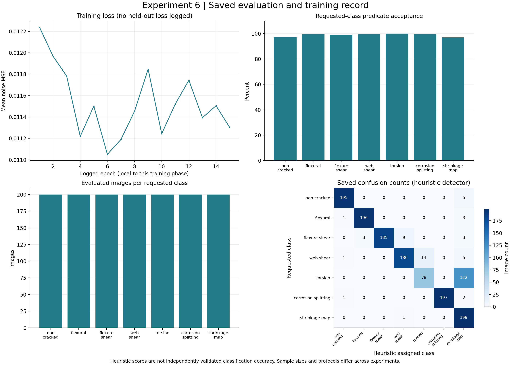
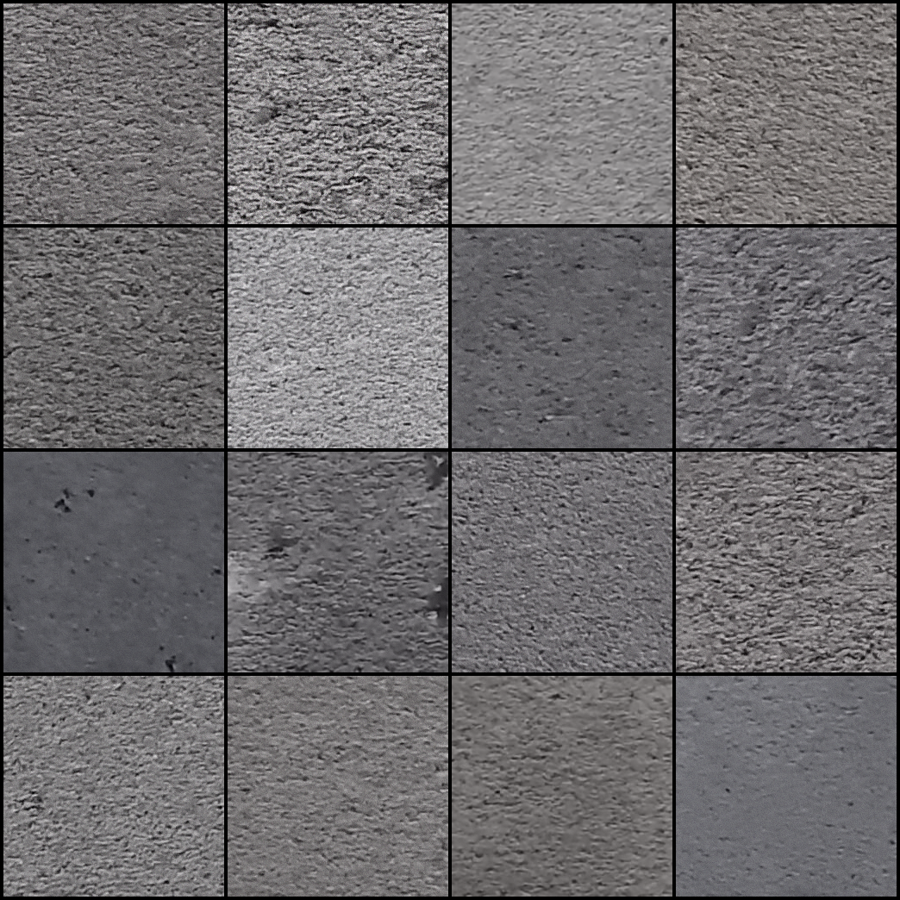
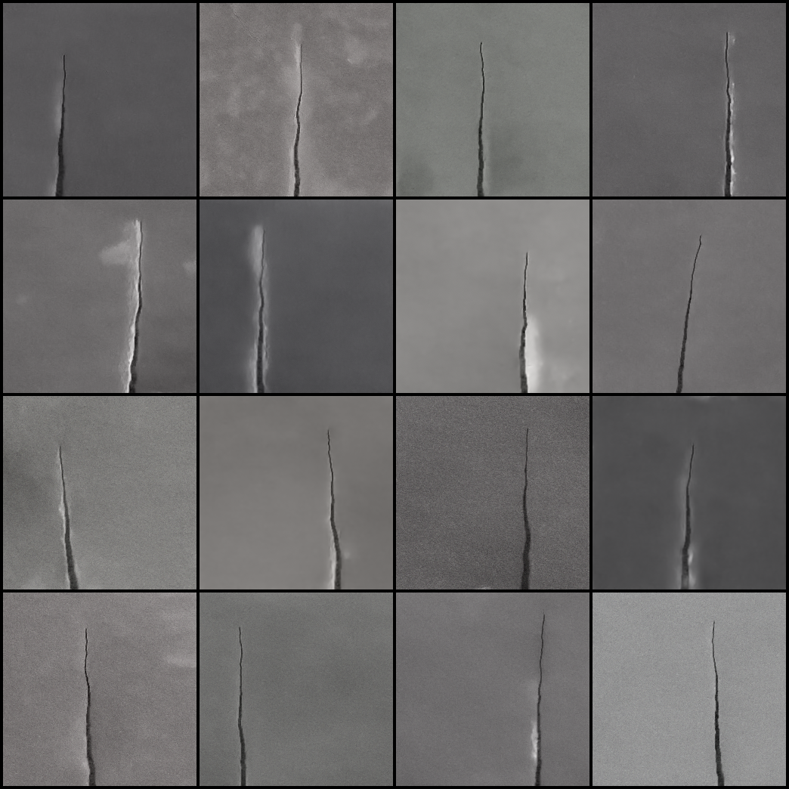
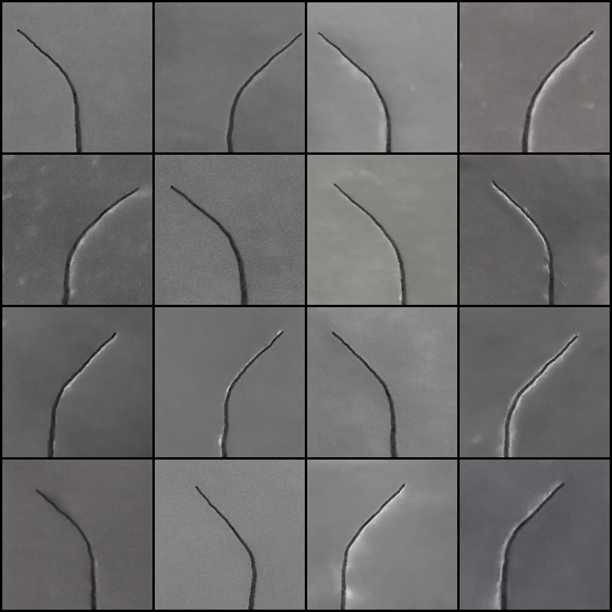
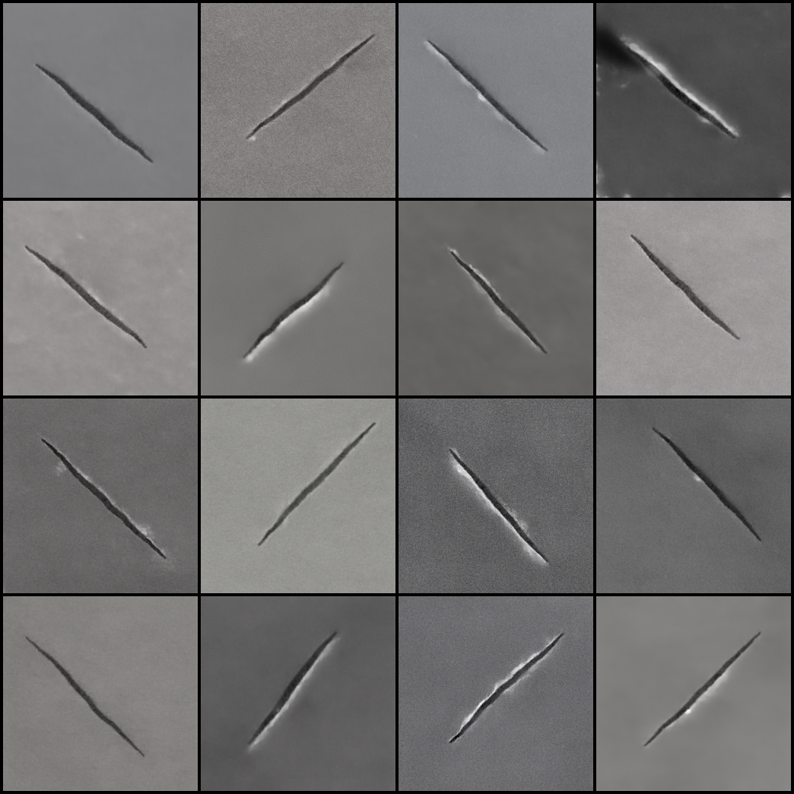
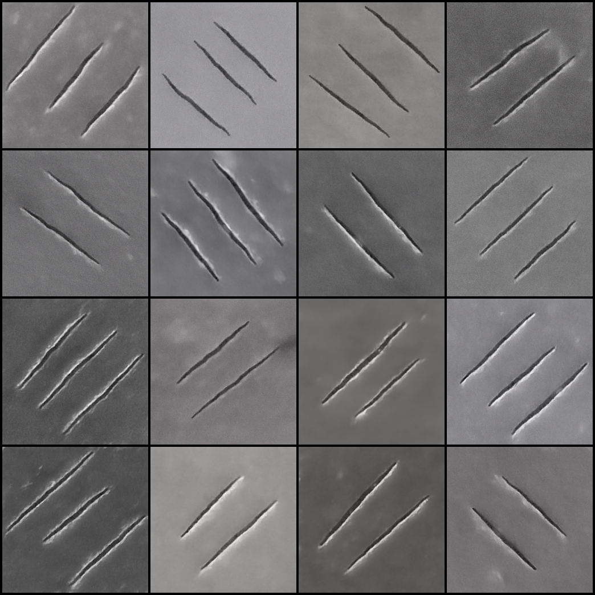
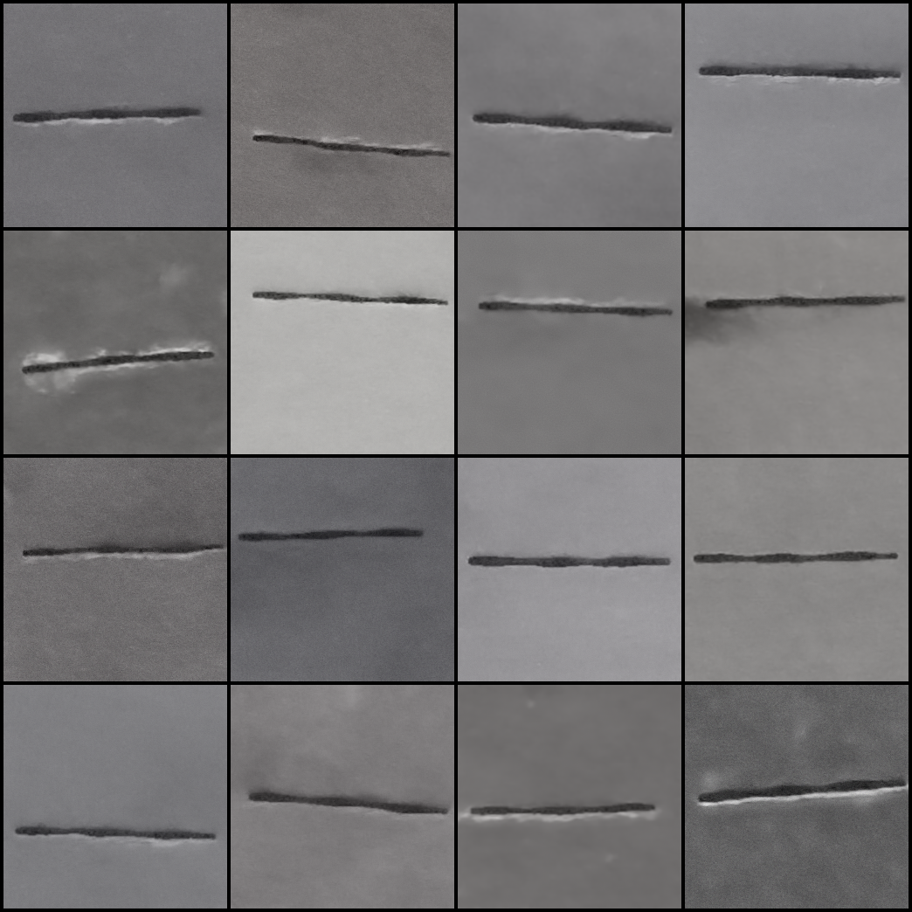
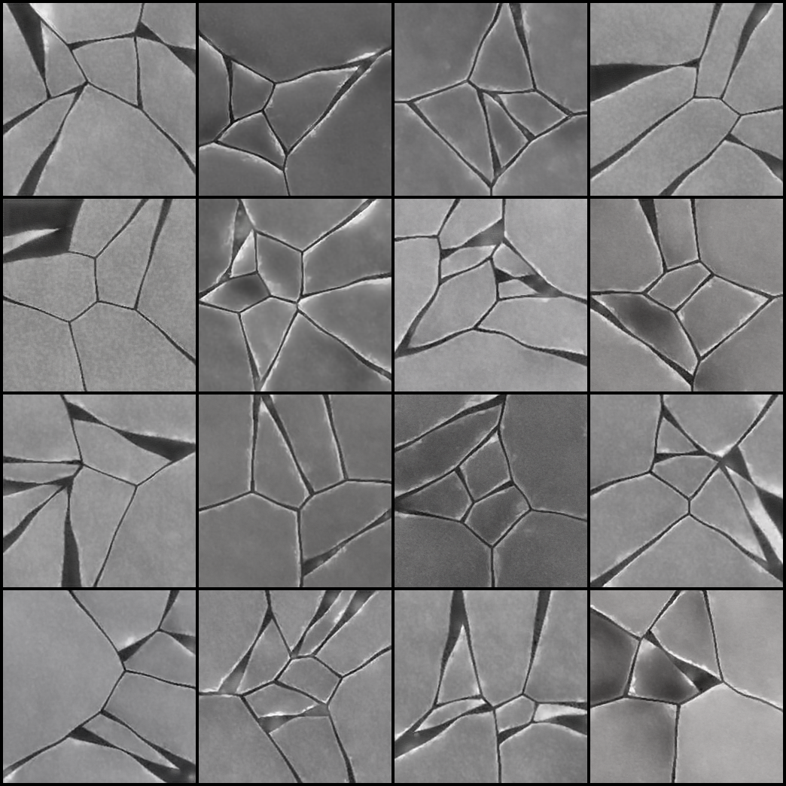

# Experiment 6 Research Report

## Spatial trajectory and aperture field conditioned crack synthesis

Revision: 2026-11-22. Study type: retrospective computational experiment. Historical checkpoint and saved evaluation; prospective validation is identified separately.

## Abstract

Experiment 6 adds two spatial conditioning channels to a transferred 256-pixel U-Net and completes 15 logged fine-tuning epochs. The five-channel checkpoint contains 13,821,043 parameters, 720 more than Exp5. The corrected image-only heuristic assigns 1,230 of 1,400 saved generated images to their requested class (87.86%); torsion agreement is 78/200 (39.00%). The earlier 99.29% figure used requested-class-dependent assignments and is superseded. A separate 126-image paired-field pilot supports sensitivity to spatial inputs, but neither that pilot nor geometric correspondence establishes physically valid fracture simulation.

## 1. Aim and research question

How closely do generated image structures correspond to supplied spatial templates, and how does the output change when those templates are zeroed or shuffled?

A spatially conditioned denoiser can learn correspondence between image-derived training fields and generated appearance. Success must be separated into image-only class agreement, template correspondence, image realism and independent physical validity.

## 2. Technical stack and model specification

| Item | Specification and provenance |
| --- | --- |
| Image shape | 256 by 256 RGB |
| Denoiser | AttentionUNet256 |
| Checkpoint tensor parameters | 13,821,043 |
| Image / conditioning channels | 3 RGB + 2 spatial fields + class embedding |
| Requested categories | 7 |
| Completed logged epochs | 15 |
| Final logged noise MSE | 0.011304028 |
| Minimum logged training MSE | 0.011051483 at local epoch 6 |
| Learning rate | 0.0001 (checkpoint optimizer) |
| Batch size provenance | Trainer default 6; historical command-line arguments not fully captured |
| Software | Python, PyTorch, torchvision, NumPy, Pillow, SciPy; Matplotlib and metric dependencies for evaluation |
| Optimizer | AdamW; beta values 0.9 and 0.999; weight decay 0.01 (saved optimizer where available, otherwise source defaults) |
| Gradient norm clipping | 1.0 in trainer source |
| Precision policy | Current historical trainer enables CUDA autocast and GradScaler; exact historical execution precision is not independently logged |
| Class dropout | 0.15 joint class/spatial dropout |
| Sampling | Historical 50-step DDIM-style CFG, reported guidance 2.5 |
| Checkpoint selection | Released phase-final checkpoint; no independently held-out selection record |
| Augmentation | Horizontal flips; vertical flips prohibited in the historical Exp5/6 source |

The parameter count is verified from the saved state dictionary. Attention is implemented through scaled-dot-product attention; the selected backend depends on runtime and hardware, so calling the implementation FlashAttention does not prove that a particular kernel executed. Historical environment/CLI provenance is incomplete. Phase-local epochs and training loss are not a controlled comparison with other experiments.

## 3. Dataset composition and provenance

| Historical source | Training-manifest records |
| --- | --- |
| DeepCrack | 6,344 |
| CrackForest | 764 |
| RC_10519 | 4,832 |
| SDNET2018 | 3,500 |

| Historical label | Records |
| --- | --- |
| corrosion_splitting | 3,506 |
| web_shear | 2,742 |
| flexure_shear | 816 |
| torsion | 1,634 |
| flexural | 944 |
| shrinkage_map | 2,298 |
| non_cracked | 3,500 |

Total historical training records: **15,440**. Source: [train.csv](../../datasets/exp5_exp6_level_bc_mechanisms_256/train.csv). These are processed patches, not counts of independent structures or photographs. Labels for the morphology/mechanism-inspired experiments are derived by image-geometry rules. The historical train/reference design and transfer ancestry do not establish independent holdout performance. Source image identities, alias grouping and current qualified manifests are discussed in Section 10.

Dataset references: SDNET2018 [R6]; DeepCrack [R7]; CrackForest [R8]; matching RC collection record [R9].

## 4. Mathematical and implementation basis

For normalized image $x_0$, the implemented forward process uses $T=1000$ and a linear variance schedule from $10^{-4}$ to $0.02$. With $\alpha_t=1-\beta_t$ and $\bar{\alpha}_t=\prod_{s=1}^{t}\alpha_s$:

$$x_t=\sqrt{\bar{\alpha}_t}x_0+\sqrt{1-\bar{\alpha}_t}\epsilon,\qquad \epsilon\sim\mathcal{N}(0,I).$$

The denoiser minimizes noise-prediction mean squared error (the expression suppresses constant normalization by the number of image elements):

$$\mathcal{L}=\mathbb{E}_{x_0,t,\epsilon}\left[\lVert\epsilon-\epsilon_\theta(x_t,t,c)\rVert_2^2\right].$$

The condition $c$ is omitted for the unconditional model. This objective is implemented in the diffusion and training modules and follows the DDPM formulation [R1]. Training MSE is an optimization diagnostic, not a perceptual, topology or physical-validity score.

The historical fast sampler uses a 50-step deterministic DDIM-style update [R2]. At the reported guidance scale $w=2.5$, it combines conditional and null predictions as

$$\hat{\epsilon}=\epsilon_{\mathrm{null}}+w\left(\epsilon_{\mathrm{cond}}-\epsilon_{\mathrm{null}}\right).$$

Classifier-free guidance [R3] changes the sampling trade-off. Finite steps, clipping, image transforms and device-dependent arithmetic preclude claiming exact invertibility or universal bitwise reproducibility. The historical sampler's implementation should be retained when reproducing historical artifacts; the prospective sampler is a separately documented protocol.

Spatial conditioning concatenates noisy RGB with two fields: $u_t=[x_t,S_0,S_1]$. Training fields come from the input image itself. Local-darkness thresholding uses a 21-pixel window and threshold 15.5, with a 2 by 2 opening and a lower-threshold fallback. Distance ridges are smoothed with Gaussian $\sigma=1.1$; aperture is $S_1=\operatorname{clip}(\operatorname{EDT}(M)/6,0,1)$. Fields are then mapped to $[-1,1]$ for network input.

Inference fields instead come from procedural templates: perturbed near-vertical paths, smoothly blended vertical/diagonal paths, single or multiple diagonals, horizontal paths, and warped nearest-seed cell boundaries. Their widths and angles are sampled in pixel units. The implementation does not consume measured loads, calibrated material parameters or structural boundary conditions; its function name does not establish a validated mechanics solver.

Chromatic normalization strongly desaturates each pixel toward $L=0.299R+0.587G+0.114B$, using $R'=L+0.08(R-L)+1.5$, $G'=L+0.08(G-L)+0.5$, and $B'=L+0.08(B-L)-1.5$, followed by clipping and integer conversion. This transform is a declared image prior, not recovered camera calibration or guaranteed exact luminance preservation.

Historical curation and evaluation use different rule sets. Curation first tests torsion-like multiplicity (at least two elongated diagonal components, each spanning at least 38 pixels, elongation at least 2.2, within 24 degrees of parallel, with component concentration 0.25–0.85), then map-like dispersion (at least four significant components and concentration below 0.48). Significant components require at least 30 pixels and span 25 pixels. Other classes require a dominant span of at least 55 pixels and concentration at least 0.52. The curved branch requires piecewise angular change at least 16 degrees, span at least 65 pixels and a vertical/diagonal half-patch transition. Near-vertical and horizontal branches use 21-degree tolerance and curvature below 20 degrees; horizontal and remaining diagonal branches require span at least 60 pixels. Branch order matters. These numerical cutoffs operationalize appearance labels, not independently identified physical causes.

## 5. Experimental procedure

1. Use the historical seven-class patch set. Normalize chromatic appearance and extract a local-darkness fissure mask from each training image.

2. Construct a smoothed distance-ridge channel and an EDT-based aperture channel from that same image. Concatenate them with noisy RGB, producing five input channels.

3. Copy the shared Exp5 backbone, retain the first three input-convolution channels and initialize the added spatial-channel weights to zero; jointly drop class and spatial information in 15% of training samples.

4. Fine-tune for 15 logged epochs. At inference, use a class-specific procedural trajectory/template generator and 50-step guided DDIM sampling.

5. Pair saved generated images with commanded fields by sample identifier, run corrected image-only heuristic assignment on all 1,400 images, and retain target-dependent geometric predicates as separate diagnostics.

6. Run the separately identified three-seed, correct/zero/shuffled field pilot with matched initial-noise states; evaluate it with both fixed and exploratory calibrated detectors.

These steps reconstruct the procedure supported by saved artifacts and current source. Defaults are distinguished from observed checkpoint/log values; a missing historical execution configuration is not silently reconstructed as a verified run command.

## 6. Evaluation protocol and statistical interpretation

The corrected evaluator predicts each class from image morphology alone, independent of the requested class and commanded field. Its fixed local-darkness mask uses window 23, threshold 24.5 and 2 by 2 opening. A second, requested-class-dependent acceptance predicate remains a separate descriptive quantity.

Command core pixels are $S_0>0.22$. Historical trajectory recall measures the fraction of command-core pixels covered after four dilation iterations of the detected mask. Distance statistics pool both command-to-detection and detection-to-command nearest-pixel distances; the stored 95th percentile is that pooled percentile, not a demonstrated physical error bound. The legacy evaluator substitutes 50 pixels for missing-detection MAE/RMSE and 80 pixels for its distance percentile. Such penalties must be identified rather than treated as measured distances. The later paired-field audit instead reports missing counts explicitly and leaves conditional distance undefined when no detection exists.

No new FID/KID score was requested in the corrected 1,400-image run (`fidelity_status: not_requested`). Earlier fidelity claims from different report versions must not be substituted into that run. New research fidelity code requires explicit reference selection and shared preprocessing, verifies manifest and pixel overlap, and refuses scientific scoring of smoke outputs.
Wilson 95% intervals summarize binomial counting uncertainty conditional on the saved generator and heuristic. They do not include training-seed variability, detector bias, source clustering or uncertainty about real mechanisms. Precision, recall and F1 computed against requested conditions quantify heuristic correspondence, not human-labeled classification accuracy. Pixel distances are in image coordinates; no physical millimetre scale is available.

For $k$ accepted outputs among $n$ requests, $\hat p=k/n$ and $z=1.95996$. The Wilson interval is

$$\frac{\hat p+z^2/(2n)\ \pm\ z\sqrt{\hat p(1-\hat p)/n+z^2/(4n^2)}}{1+z^2/n}.$$

For saved count matrix $A$, $A_{ij}$ counts request $i$ assigned heuristic class $j$. Row agreement is $A_{ii}/\sum_j A_{ij}$; proxy precision is $A_{ii}/\sum_j A_{ji}$; $F_1=2PR/(P+R)$, with zero used for undefined zero-denominator cases. These definitions explain the table without changing the meaning of requested labels into ground truth.

## 7. Results

Overall requested-label agreement: **1,230 / 1,400 (87.86%)**. The following intervals are calculated from the saved counts; precision and F1 also use these counts rather than rounded JSON rates.

| Requested class | Diagonal / requested | Agreement | Wilson 95% interval | Proxy precision | Proxy F1 |
| --- | --- | --- | --- | --- | --- |
| non_cracked | 195 / 200 | 97.50% | 94.28–98.93% | 98.48% | 0.9799 |
| flexural | 196 / 200 | 98.00% | 94.97–99.22% | 98.49% | 0.9825 |
| flexure_shear | 185 / 200 | 92.50% | 88.00–95.40% | 100.00% | 0.9610 |
| web_shear | 180 / 200 | 90.00% | 85.06–93.43% | 94.74% | 0.9231 |
| torsion | 78 / 200 | 39.00% | 32.51–45.91% | 84.78% | 0.5342 |
| corrosion_splitting | 197 / 200 | 98.50% | 95.68–99.49% | 100.00% | 0.9924 |
| shrinkage_map | 199 / 200 | 99.50% | 97.22–99.91% | 58.70% | 0.7384 |

Confusion counts, with requested classes in rows and heuristic-assigned classes in columns:

| Requested / assigned | non_cracked | flexural | flexure_shear | web_shear | torsion | corrosion_splitting | shrinkage_map |
| --- | --- | --- | --- | --- | --- | --- | --- |
| non_cracked | 195 | 0 | 0 | 0 | 0 | 0 | 5 |
| flexural | 1 | 196 | 0 | 0 | 0 | 0 | 3 |
| flexure_shear | 0 | 3 | 185 | 9 | 0 | 0 | 3 |
| web_shear | 1 | 0 | 0 | 180 | 14 | 0 | 5 |
| torsion | 0 | 0 | 0 | 0 | 78 | 0 | 122 |
| corrosion_splitting | 1 | 0 | 0 | 0 | 0 | 197 | 2 |
| shrinkage_map | 0 | 0 | 0 | 1 | 0 | 0 | 199 |

The next table preserves the **separate target-dependent predicate and command-correspondence diagnostics**. Its acceptance column is not the diagonal of the confusion matrix.

| Requested class | Target predicate acceptance | Trajectory recall | Legacy trajectory MAE px | Pooled distance 95th percentile px | Taper error ratio units |
| --- | --- | --- | --- | --- | --- |
| flexural | 99.50% | 99.30% | 0.335 | 1.705 | 1.393 |
| flexure_shear | 99.00% | 99.92% | 0.264 | 1.55 | 0.513 |
| web_shear | 99.50% | 99.68% | 0.292 | 1.524 | 0.063 |
| torsion | 100.00% | 99.81% | 0.191 | 1.143 | 0.05 |
| corrosion_splitting | 99.50% | 99.83% | 0.673 | 2.545 | 0.098 |
| shrinkage_map | 97.00% | 94.11% | 0.61 | 3.602 | 0.819 |

### Fidelity status

The corrected primary run did not compute FID/KID. No fidelity number is inferred from another report version.


### Separately stored legacy fidelity record

The pre-revision metric artifact also stores the following fidelity values. They are retained as a separate historical diagnostic, not as newly computed results of the corrected classification run.

| Legacy metric | Stored value |
| --- | --- |
| frechet_inception_distance | 268.008 |
| kernel_inception_distance_mean | 0.17717 |
| kernel_inception_distance_std | 0.01135 |
| evaluated_fake_samples | 1400 |
| evaluated_real_samples | 1400 |

The legacy evaluator uses torchvision Inception features after 299-pixel resizing and ImageNet normalization, with a chromatic transform applied to real references but not to generated images. That asymmetric preprocessing, training-reference exposure and the absence of a complete frozen reference manifest limit interpretation. The previous comparison with an N=112 score also changes sample budget; a lower FID at N=1,400 does not isolate an improvement in model quality. The prospective fidelity implementation instead applies the declared transform consistently to both sides. The exact earlier artifact is retained at [original_stored_metrics.json](../../experiments/exp6_level_c_spatial_physics/report_archive/20261122-original/original_stored_metrics.json).


### Saved plots and generated examples



Figure interpretation: phase-local training loss, detector-defined rates and saved sample counts. This figure is a descriptive summary, not a controlled leaderboard or an independently labeled accuracy assessment.

### Archived illustrative outputs

The following saved illustrations retain their available filenames and request labels. Their membership in the quantified collection is not assumed without an original sampling manifest. They are not a blinded quality study, and their labels are not independent human judgments. The quantitative tables retain the complete stated evaluation denominators.



Non-cracked. Source illustration: `exp6_non_cracked_256_grid.png`.



Flexural. Source illustration: `exp6_flexural_256_grid.png`.



Flexure-shear. Source illustration: `exp6_flexure_shear_256_grid.png`.



Web shear. Source illustration: `exp6_web_shear_256_grid.png`.



Torsion. Source illustration: `exp6_torsion_256_grid.png`.



Corrosion splitting. Source illustration: `exp6_corrosion_splitting_256_grid.png`.



Shrinkage / map. Source illustration: `exp6_shrinkage_map_256_grid.png`.

## 8. Observations and discussion

The most consequential corrected failure is torsion-to-map confusion: 122 of 200 torsion requests are assigned shrinkage-map by the image-only heuristic. The legacy target-dependent torsion predicate still accepts all 200 outputs, which shows why predicate acceptance cannot substitute for independent assignment. High trajectory recall also does not by itself imply precise tracing: broad or noisy dark masks can cover a commanded corridor. Balanced precision/recall/F1 is implemented for the prospective pipeline, but the historical main evaluation should not be relabeled as having completed that new protocol.

This experiment changes several design factors relative to other phases. Resolution, training images, label taxonomy, transfer ancestry, color processing, sampler and evaluator may differ. A before/after visual comparison is therefore hypothesis-generating; no causal attribution to a single architectural or conditioning change is made.

## 9. Assumptions and their consequences

| Assumption | Implementation or rationale | Consequence and validation status |
| --- | --- | --- |
| C1 Spatial fields | Image-derived ridge and EDT fields encode visible crack geometry. | Self-supervised image proxies, not measured stress, strain or calibrated crack opening. |
| C2 Command generator | Procedural class templates approximate mechanism-inspired crack shapes. | The implementation samples shapes, angles, widths and warped cell boundaries; it is not a solved boundary-value fracture model. |
| C3 Input-channel surgery | Zero-initialized extra channels preserve the initial RGB convolution contribution. | Architectural initialization property; no guarantee of convergence, compliance or realism after training. |
| C4 Chromatic transform | Strong desaturation and channel offsets reduce unwanted tints. | Changes image distribution; clipping/quantization prevent a guarantee of perfect luminance preservation. |
| C5 Joint CFG | Class and spatial fields are dropped together during training. | Zero-field plus present-class ablations can be outside the historical conditioning distribution. |
| Train/inference correspondence | Image-extracted fields and procedural inference fields have compatible distributions. | Unverified domain-transfer assumption requiring controlled validation. |
| Pixel geometry | Distances and widths in pixels are meaningful image measurements. | No millimetre scale, material properties, equilibrium residual or structural safety assessment is established. |

All image-derived labels assume that visible dark geometry is informative about the intended visual attribute. Real masks, bounding boxes and class labels answer different annotation questions. Additional annotations or a mechanics-inspired name do not independently verify a failure mechanism.

Material and member context is an additional unverified assumption: the multi-source collection includes road-crack imagery [R8], and the available patch metadata do not establish concrete material, reinforcement layout or member/load history for every record. The report therefore treats the labels as appearance proxies rather than material-specific diagnoses.

## 10. Completed audits and prospective validation

The prospective **research_v5** manifests contain the following base partition counts. They were constructed after the historical training and do not retroactively make its checkpoints unseen-data models.

| Partition | Base records |
| --- | --- |
| train | 12,357 |
| validation | 1,565 |
| test | 1,518 |

The shared source audit covers 67,264 originals, with 65,866 distinct decoded RGB images and 1,398 extra exact decoded copies. The v4 perceptual screen found 386 cross-split candidates. V5 conservatively links all 1,111 candidate pairs, including within-split pairs, before assignment; the same pHash ≤3 and dHash ≤6 search then finds zero cross-split candidates. This limited, uncalibrated screen can miss crops, rotations, flips and larger edits. Source names and zero screened matches do not prove site or structure independence.

RC attribution identifies a matching Mendeley record [R9] and its requested paper [R10]. Local ZIP sizes/CRCs match extracted files, but no publisher digest established local archive identity. All 10,519 local JSON files contain crack rectangles; these boxes do not validate image-level labels, pixel masks or structural mechanisms. The geometry audit flags 1,145 source annotations, including 1,122 out-of-bounds cases and 150 image/annotation dimension mismatches; categories overlap.

The prospective `strict_rc_geometry_v1` view excludes 481 affected Exp5/6 records (371 train, 67 validation, 43 test), retains all seven proxy classes and preserves v5 component assignments. Exclusion is conservative; it does not prove every excluded label wrong or every retained label correct.

| Partition | Qualified records |
| --- | --- |
| train | 11,986 |
| validation | 1,498 |
| test | 1,475 |

Scratch training, EMA selection on fixed-noise validation, provenance-checked generation and geometry/fidelity preflight are implemented for the new lineage. Their bounded smoke runs are infrastructure checks. Full clean multi-seed training, independently labeled generated images, external validation and downstream detector utility have not been established by the historical artifacts. A prepared campaign is not a completed experiment.

Computational sharing was tested in a fresh Windows/Python 3.10 CPU environment: the public weights were downloaded and verified and one image per experiment was generated without raw datasets. This confirms that inference can execute under that environment; it does not reproduce model training or validate image quality.

### Detector validation and exploratory calibration

The fixed detector was compared with pixel masks on 51 DeepCrack originals (102 nonoverlapping native tiles). Its pixel precision/recall/IoU/Dice were 33.69% / 58.81% / 27.26% / 42.84%. A 24-setting validation-only search on 46 originals selected window 31, threshold 30 and opening 2. On the archived 51-original test selection, precision/recall/IoU/Dice became 42.36% / 61.25% / 33.41% / 50.08%. The original-image cluster-bootstrap paired IoU gain was 6.15 percentage points (95% interval 5.04–7.31). These selections belong to archived research_v1, and test results had previously been inspected, so this is exploratory detector evidence, not a new untouched test of the generator or generated-image mechanism labels.

### Paired field sensitivity pilot

The pilot contains 126 images: seven classes, three seeds, two commands per class/seed and three field conditions. Cracked-image summaries use 36 images per condition. Initial random states were matched and non-cracked controls were byte-identical. Outputs are evaluated against the original correct command.

| Detector | Input field | Cracked images | Trajectory recall | Missing detections | Conditional MAE px |
| --- | --- | --- | --- | --- | --- |
| fixed | correct | 36 | 98.61% | 0 | 0.474 |
| fixed | zero | 36 | 0.00% | 36 | Undefined |
| fixed | shuffled | 36 | 11.25% | 0 | 27.955 |
| calibrated | correct | 36 | 98.07% | 0 | 0.510 |
| calibrated | zero | 36 | 0.00% | 36 | Undefined |
| calibrated | shuffled | 36 | 11.07% | 0 | 27.918 |

This supports input-field sensitivity for the historical checkpoint. The zero-field/present-class combination may be out of distribution because historical dropout removed both together. It is not a separately trained matched class-only baseline and cannot establish physical causation. Distances must be read alongside missing-detection counts.

## 11. Sources of error and errors identified

| Identified issue | Correction or interpretation |
| --- | --- |
| 99.29% labeled independent seven-class accuracy | Superseded by the corrected morphology-only matrix: 1,230/1,400 agreements. |
| Procedural generator described as guaranteed physically valid | The code does not solve a calibrated fracture boundary-value problem or validate equilibrium/material failure. |
| High recall treated as sufficient template fidelity | Report false positives, precision and missing detections alongside recall; distances are conditional when detections are absent. |
| Zero-field pilot described as a trained class-only baseline | It is an input ablation on a historical checkpoint; a separately trained matched class-only control remains pending. |
| New split and quality audits presented as validation of old models | The historical weights and transfer ancestors remain exposed to earlier data. |

Further threats include segmentation sensitivity to texture and illumination; source overlap and patch clustering; heuristic circularity between curation and evaluation; small or unequal sample budgets; image-derived versus procedurally generated conditioning; reference preprocessing differences; and incomplete historical execution metadata. No structural safety, real crack width, downstream detection benefit, state-of-the-art performance or physical-cause accuracy is claimed from these measurements.

## 12. Conclusion

Experiment 6 provides the strongest direct evidence of spatial input sensitivity in the project, together with a corrected 1,400-image morphology evaluation. The defensible claim is controllable image-template correspondence under the studied heuristics. Physical fracture validity, expert mechanism correctness, clean generalization and downstream inspection utility remain open research questions.

## 13. Reproducibility and artifact record

The released historical weights are used for inference; these commands do not start training. Run from the repository root with the documented dependencies and a fresh output directory.

```powershell
.\.venv\Scripts\python.exe pipeline/download_models.py
.\.venv\Scripts\python.exe pipeline/checkpoints.py verify
.\.venv\Scripts\python.exe pipeline/generate_cracks.py --experiment 6 --crack-type all --count 1 --seed 2026 --output-dir experiments/exp6_level_c_spatial_physics/report_replication_seed2026
```

A fixed seed requires matching checkpoints, sampling settings, device and software for comparable execution; it does not guarantee cross-device pixel identity or exact replication of a historical example grid. Research training uses a separate scratch lineage and must not overwrite these final weights.

| Evidence | Artifact |
| --- | --- |
| Primary metric record | [EVALUATION_METRICS.json](../../experiments/exp6_level_c_spatial_physics/evaluation_corrected/EVALUATION_METRICS.json) |
| Training log | [training_loss.csv](../../experiments/exp6_level_c_spatial_physics/logs/training_loss.csv) |
| Checkpoint SHA256 | a70f8eea4385c8ecdaf028ed748cb5b5ac8db3747ee8da85e10f218bfd48f7c6 |
| Input hashes and revision archive | [report_evidence.json](../../experiments/exp6_level_c_spatial_physics/report_evidence.json) |
| Training source | [train_exp6_spatial_physics_256.py](../../src/train_exp6_spatial_physics_256.py) |
| Evaluation source | [evaluate_exp6_spatial_physics_256.py](../../src/evaluate_exp6_spatial_physics_256.py) |

Code is available in the [project repository](https://github.com/AlgoRubic/Crack-Image-Generation). The six historical checkpoints are distributed in the [versioned model release](https://github.com/AlgoRubic/Crack-Image-Generation/releases/tag/historical-models-v1), with a checksum manifest. Raw datasets are not included in that inference bundle. Dataset references identify their publishers, while local source inventories record observed archive hashes and outstanding identity/annotation limitations.


The machine-readable evidence file records input SHA256 values, checkpoint metadata, log handling and exact archived pre-revision sources. The historical reports remain recoverable and are superseded where their claims conflict with the corrected tables above. Original sampling files do not provide a complete checkpoint-hash chain for every historical evaluation image; association with the released phase checkpoint follows the available procedural record. No new generation, training or rerun of image-evaluation algorithms is implied by this revision. Counts, Wilson intervals and derived matrix statistics are calculated from saved artifacts.

## 14. References

[R1] Ho, Jain and Abbeel (2020). Denoising Diffusion Probabilistic Models. [Source](https://arxiv.org/abs/2006.11239)

[R2] Song, Meng and Ermon (2020; ICLR 2021). Denoising Diffusion Implicit Models. [Source](https://arxiv.org/abs/2010.02502)

[R3] Ho and Salimans (2022). Classifier-Free Diffusion Guidance. [Source](https://arxiv.org/abs/2207.12598)

[R4] Heusel et al. (2017). FID proposal in GANs Trained by a Two Time-Scale Update Rule Converge to a Local Nash Equilibrium. [Source](https://arxiv.org/abs/1706.08500)

[R5] Bińkowski et al. (2018). Demystifying MMD GANs; KID proposal. [Source](https://arxiv.org/abs/1801.01401)

[R6] SDNET2018 dataset and acquisition documentation. [Source](https://digitalcommons.usu.edu/all_datasets/48/)

[R7] DeepCrack source repository, masks and dataset splits. [Source](https://github.com/yhlleo/DeepCrack)

[R8] CrackForest source repository and citation. [Source](https://github.com/cuilimeng/CrackForest-dataset)

[R9] Wang (2026). Reinforced concrete structure crack detection dataset 10519, Mendeley Data v1. DOI 10.17632/3ghxck2wd5.1. [Source](https://data.mendeley.com/datasets/3ghxck2wd5/1)

[R10] Wang et al. (2024). Automatic detection of building surface cracks using UAV and deep learning-combined approach. Structural Concrete 25(4), 2302–2322. [Source](https://doi.org/10.1002/suco.202300937)
