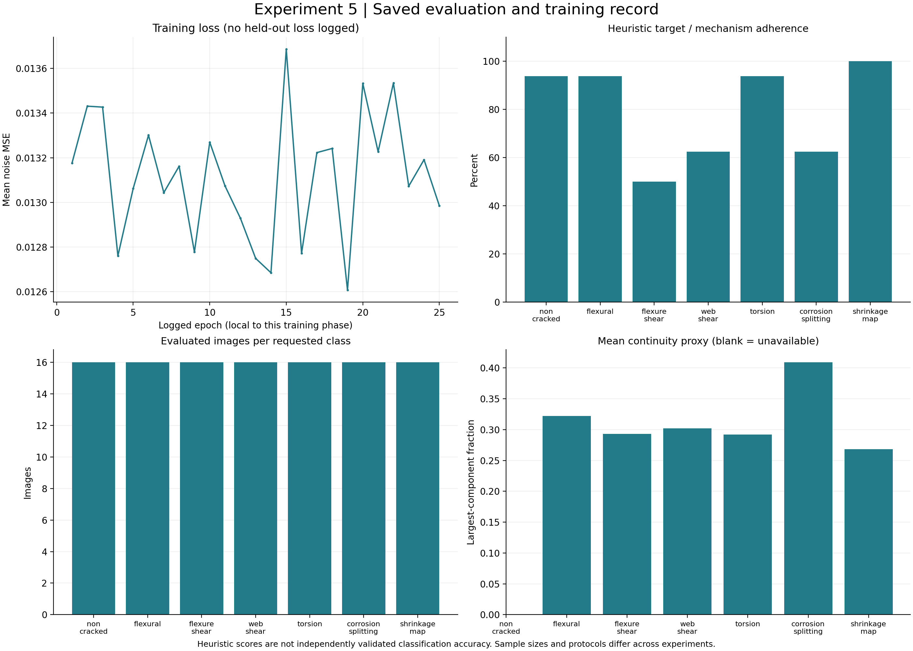
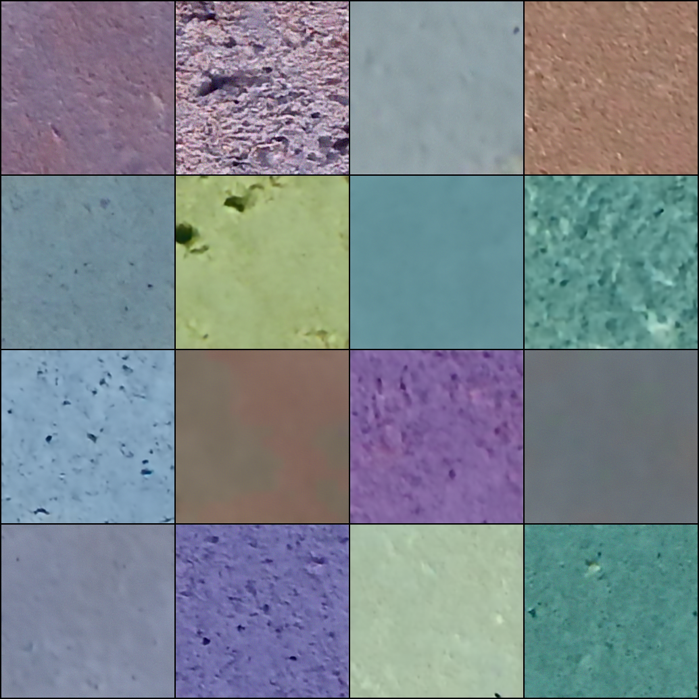
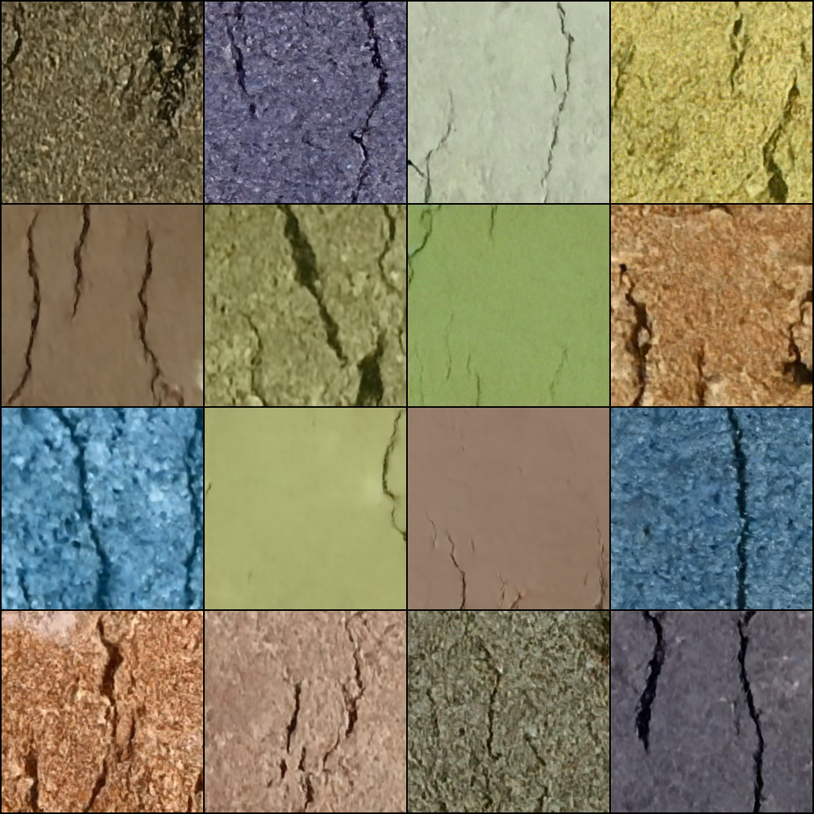
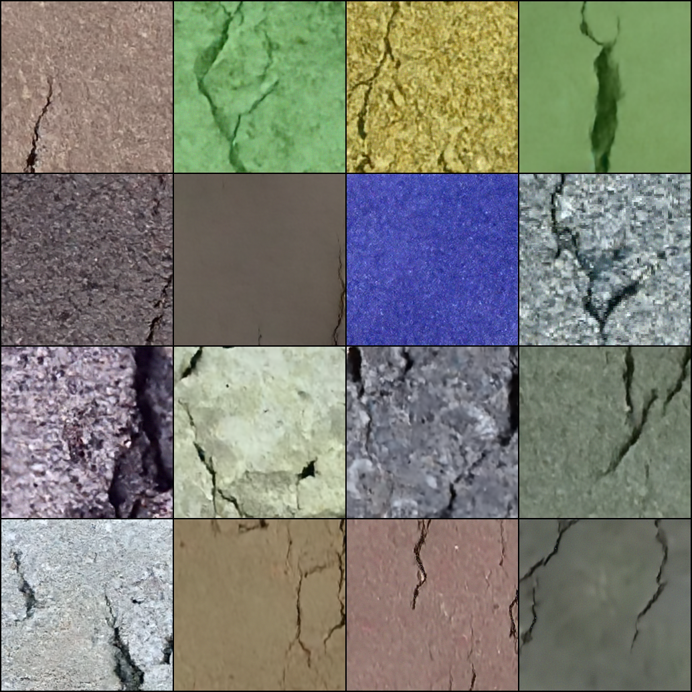
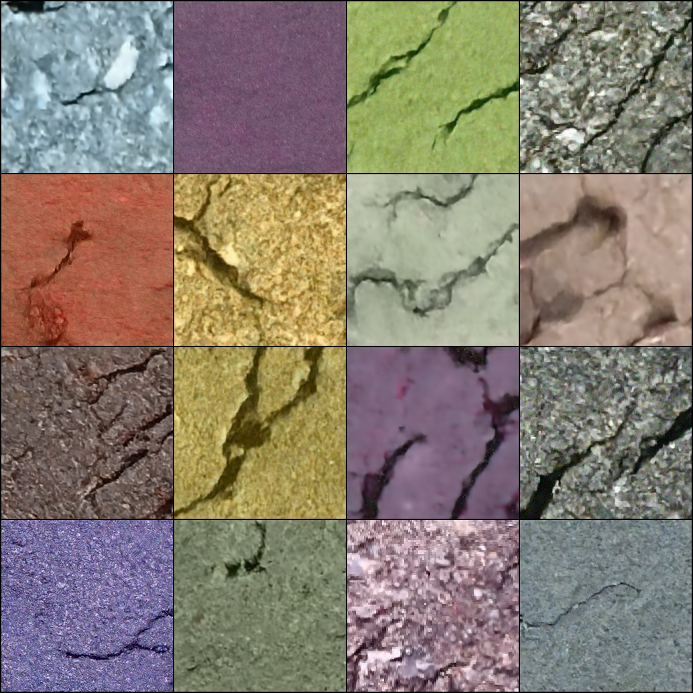
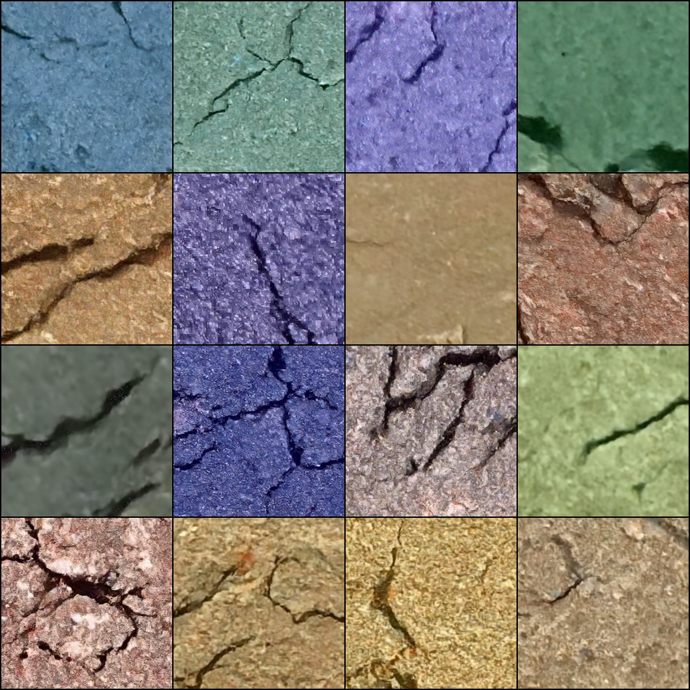
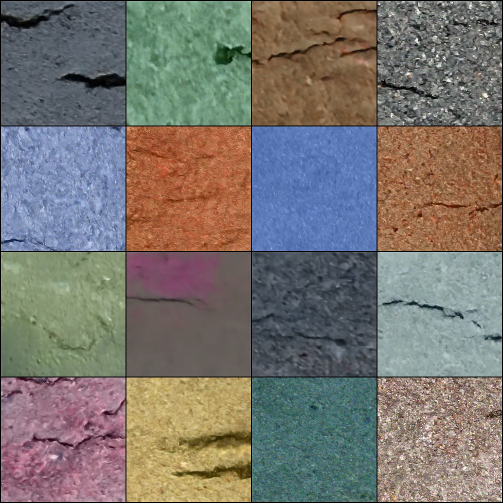
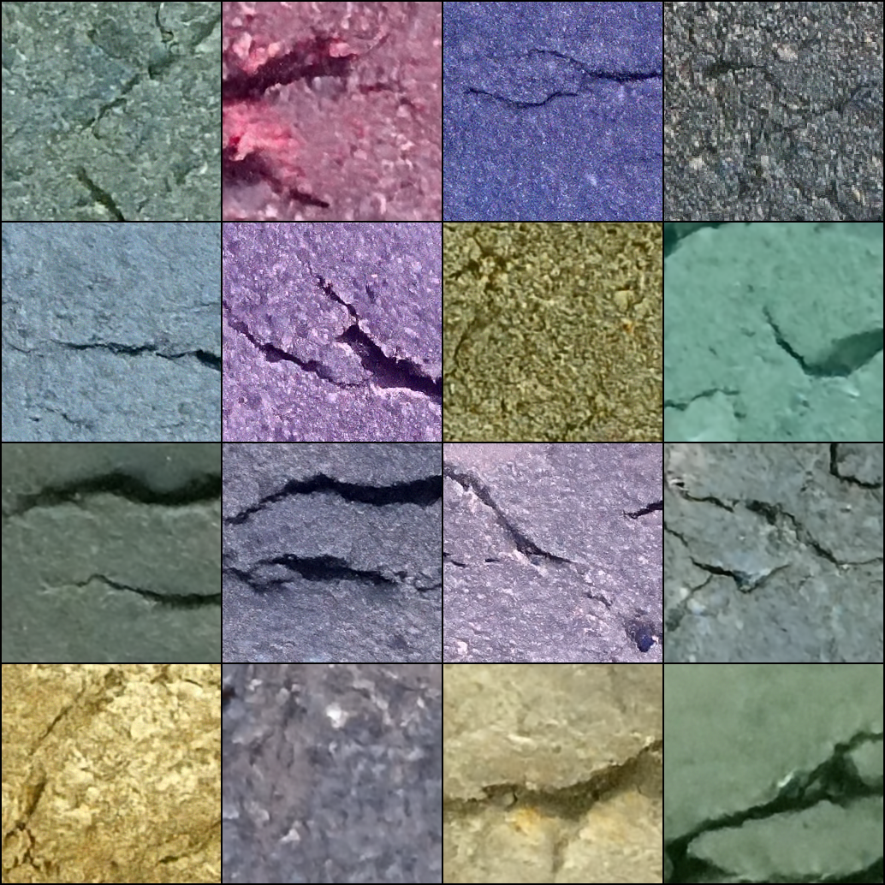

# Experiment 5 Research Report

## Seven mechanism inspired morphology classes with transfer learning

Revision: 2026-11-22. Study type: retrospective computational experiment. Historical checkpoint and saved evaluation; prospective validation is identified separately.

## Abstract

Experiment 5 expands the label space to seven mechanism-inspired morphology categories and documents transfer from the Exp4 attention backbone. The historical training set has 15,440 patches and the phase completes 25 logged epochs with final noise MSE 0.012985. On 112 saved generated images, class-specific heuristic acceptance ranges from 50.00% for flexure-shear to 100.00% for shrinkage-map. These predicates depend on the requested class and are not a seven-class independent classifier. Local source and annotation audits further qualify the dataset: the prospective Exp5/6 view excludes 481 flagged RC records.

## 1. Aim and research question

Can a class-conditioned generator express geometry patterns inspired by named failure mechanisms while retaining a compact attention backbone?

Orientation, curvature, component multiplicity and apparent width taper can provide useful controllable visual proxies. Their correspondence to real loading, reinforcement, corrosion or shrinkage causes requires source context and independent expert labels.

## 2. Technical stack and model specification

| Item | Specification and provenance |
| --- | --- |
| Image shape | 256 by 256 RGB |
| Denoiser | AttentionUNet256 |
| Checkpoint tensor parameters | 13,820,323 |
| Image / conditioning channels | 3 RGB + class embedding |
| Requested categories | 7 |
| Completed logged epochs | 25 |
| Final logged noise MSE | 0.012984928 |
| Minimum logged training MSE | 0.012606775 at local epoch 19 |
| Learning rate | 0.0001 (checkpoint optimizer) |
| Batch size provenance | Trainer default 6; historical command-line arguments not fully captured |
| Software | Python, PyTorch, torchvision, NumPy, Pillow, SciPy; Matplotlib and metric dependencies for evaluation |
| Optimizer | AdamW; beta values 0.9 and 0.999; weight decay 0.01 (saved optimizer where available, otherwise source defaults) |
| Gradient norm clipping | 1.0 in trainer source |
| Precision policy | Current historical trainer enables CUDA autocast and GradScaler; exact historical execution precision is not independently logged |
| Class dropout | 0.15 in Exp5 source |
| Sampling | Historical 50-step DDIM-style CFG, reported guidance 2.5 |
| Checkpoint selection | Released phase-final checkpoint; no independently held-out selection record |
| Augmentation | Horizontal flips; vertical flips prohibited in the historical Exp5/6 source |

The parameter count is verified from the saved state dictionary. Attention is implemented through scaled-dot-product attention; the selected backend depends on runtime and hardware, so calling the implementation FlashAttention does not prove that a particular kernel executed. Historical environment/CLI provenance is incomplete. Phase-local epochs and training loss are not a controlled comparison with other experiments.

## 3. Dataset composition and provenance

| Historical source | Training-manifest records |
| --- | --- |
| DeepCrack | 6,344 |
| CrackForest | 764 |
| RC_10519 | 4,832 |
| SDNET2018 | 3,500 |

| Historical label | Records |
| --- | --- |
| corrosion_splitting | 3,506 |
| web_shear | 2,742 |
| flexure_shear | 816 |
| torsion | 1,634 |
| flexural | 944 |
| shrinkage_map | 2,298 |
| non_cracked | 3,500 |

Total historical training records: **15,440**. Source: [train.csv](../../datasets/exp5_exp6_level_bc_mechanisms_256/train.csv). These are processed patches, not counts of independent structures or photographs. Labels for the morphology/mechanism-inspired experiments are derived by image-geometry rules. The historical train/reference design and transfer ancestry do not establish independent holdout performance. Source image identities, alias grouping and current qualified manifests are discussed in Section 10.

Dataset references: SDNET2018 [R6]; DeepCrack [R7]; CrackForest [R8]; matching RC collection record [R9].

## 4. Mathematical and implementation basis

For normalized image $x_0$, the implemented forward process uses $T=1000$ and a linear variance schedule from $10^{-4}$ to $0.02$. With $\alpha_t=1-\beta_t$ and $\bar{\alpha}_t=\prod_{s=1}^{t}\alpha_s$:

$$x_t=\sqrt{\bar{\alpha}_t}x_0+\sqrt{1-\bar{\alpha}_t}\epsilon,\qquad \epsilon\sim\mathcal{N}(0,I).$$

The denoiser minimizes noise-prediction mean squared error (the expression suppresses constant normalization by the number of image elements):

$$\mathcal{L}=\mathbb{E}_{x_0,t,\epsilon}\left[\lVert\epsilon-\epsilon_\theta(x_t,t,c)\rVert_2^2\right].$$

The condition $c$ is omitted for the unconditional model. This objective is implemented in the diffusion and training modules and follows the DDPM formulation [R1]. Training MSE is an optimization diagnostic, not a perceptual, topology or physical-validity score.

The historical fast sampler uses a 50-step deterministic DDIM-style update [R2]. At the reported guidance scale $w=2.5$, it combines conditional and null predictions as

$$\hat{\epsilon}=\epsilon_{\mathrm{null}}+w\left(\epsilon_{\mathrm{cond}}-\epsilon_{\mathrm{null}}\right).$$

Classifier-free guidance [R3] changes the sampling trade-off. Finite steps, clipping, image transforms and device-dependent arithmetic preclude claiming exact invertibility or universal bitwise reproducibility. The historical sampler's implementation should be retained when reproducing historical artifacts; the prospective sampler is a separately documented protocol.

Historical curation and evaluation use different rule sets. Curation first tests torsion-like multiplicity (at least two elongated diagonal components, each spanning at least 38 pixels, elongation at least 2.2, within 24 degrees of parallel, with component concentration 0.25–0.85), then map-like dispersion (at least four significant components and concentration below 0.48). Significant components require at least 30 pixels and span 25 pixels. Other classes require a dominant span of at least 55 pixels and concentration at least 0.52. The curved branch requires piecewise angular change at least 16 degrees, span at least 65 pixels and a vertical/diagonal half-patch transition. Near-vertical and horizontal branches use 21-degree tolerance and curvature below 20 degrees; horizontal and remaining diagonal branches require span at least 60 pixels. Branch order matters. These numerical cutoffs operationalize appearance labels, not independently identified physical causes.

## 5. Experimental procedure

1. Combine DeepCrack training and test originals, CrackForest masks, RC box-guided fissure extraction and SDNET non-cracked patches into the historical 15,440-patch manifest.

2. Map mask geometry to seven proxy classes, canonically orient selected patches and prohibit vertical flipping in the historical mechanism trainer.

3. Initialize shared weights from Exp4 and construct the expanded class embedding table using the documented projection recipe; fine-tune for 25 logged epochs.

4. Generate 16 saved examples per class, apply the requested-class predicate, and compute the separate historical feature-distance diagnostic against selected training references.

These steps reconstruct the procedure supported by saved artifacts and current source. Defaults are distinguished from observed checkpoint/log values; a missing historical execution configuration is not silently reconstructed as a verified run command.

## 6. Evaluation protocol and statistical interpretation

The evaluator uses local-darkness mask extraction (23-pixel window, threshold 24.5 and 2 by 2 opening), then component geometry. Flexural acceptance requires detected presence and a near-vertical principal orientation; flexure-shear requires presence and piecewise angular change of at least 14 degrees; web-shear and splitting use diagonal/horizontal orientation predicates. Torsion accepts at least two diagonal or significant components, and map acceptance uses at least three components and concentration below 0.65, without the same presence gate. These predicates explicitly depend on the requested class. Historical torch-fidelity FID/KID selects up to 16 training-reference patches per class and uses eight KID subsets of size 12. It is a training-reference diagnostic, not an unseen-data validation.
Wilson 95% intervals summarize binomial counting uncertainty conditional on the saved generator and heuristic. They do not include training-seed variability, detector bias, source clustering or uncertainty about real mechanisms. Precision, recall and F1 computed against requested conditions quantify heuristic correspondence, not human-labeled classification accuracy. Pixel distances are in image coordinates; no physical millimetre scale is available.

For $k$ accepted outputs among $n$ requests, $\hat p=k/n$ and $z=1.95996$. The Wilson interval is

$$\frac{\hat p+z^2/(2n)\ \pm\ z\sqrt{\hat p(1-\hat p)/n+z^2/(4n^2)}}{1+z^2/n}.$$

## 7. Results

| Requested class | Images | Accepted count | Predicate acceptance | Wilson 95% interval | Continuity proxy |
| --- | --- | --- | --- | --- | --- |
| non_cracked | 16 | 15 / 16 | 93.75% | 71.67–98.89% | Not reported |
| flexural | 16 | 15 / 16 | 93.75% | 71.67–98.89% | 0.322 |
| flexure_shear | 16 | 8 / 16 | 50.00% | 28.00–72.00% | 0.293 |
| web_shear | 16 | 10 / 16 | 62.50% | 38.64–81.52% | 0.302 |
| torsion | 16 | 15 / 16 | 93.75% | 71.67–98.89% | 0.292 |
| corrosion_splitting | 16 | 10 / 16 | 62.50% | 38.64–81.52% | 0.409 |
| shrinkage_map | 16 | 16 / 16 | 100.00% | 80.64–100.00% | 0.268 |

Counts are arithmetic reconstructions from the saved rates and denominators. These class-specific predicates are not an independently assigned multiclass confusion matrix.

### Protocol-qualified feature diagnostic

| Saved metric | Value |
| --- | --- |
| frechet_inception_distance | 170.582 |
| kernel_inception_distance_mean | 0.03931 |
| kernel_inception_distance_std | 0.01168 |

FID and KID summarize feature distributions [R4, R5]; they do not certify crack presence or physical validity. Reference exposure, sample count, feature extraction and image preprocessing are part of the metric definition. Do not rank this value against experiments using another implementation or a different reference distribution.


### Saved plots and generated examples



Figure interpretation: phase-local training loss, detector-defined rates and saved sample counts. This figure is a descriptive summary, not a controlled leaderboard or an independently labeled accuracy assessment.

### Archived illustrative outputs

The following saved illustrations retain their available filenames and request labels. Their membership in the quantified collection is not assumed without an original sampling manifest. They are not a blinded quality study, and their labels are not independent human judgments. The quantitative tables retain the complete stated evaluation denominators.



Non-cracked. Source illustration: `non_cracked_256_grid.png`.



Flexural. Source illustration: `flexural_256_grid.png`.



Flexure-shear. Source illustration: `flexure_shear_256_grid.png`.



Web shear. Source illustration: `web_shear_256_grid.png`.



Torsion. Source illustration: `torsion_256_grid.png`.



Corrosion splitting. Source illustration: `corrosion_splitting_256_grid.png`.



Shrinkage / map. Source illustration: `shrinkage_map_256_grid.png`.

## 8. Observations and discussion

Sixteen examples per class give a coarse 6.25 percentage-point resolution and cannot establish robust class-level performance. The torsion and map acceptance rules do not require the same crack-presence gate as the other rules. Accordingly, torsion acceptance (15/16) exceeds its presence count (13/16), and map acceptance (16/16) exceeds its presence count (13/16). These are different predicates, not contradictory estimates of one accuracy quantity. The geometry-to-mechanism mapping is a modeling assumption rather than a recovered physical diagnosis.

This experiment changes several design factors relative to other phases. Resolution, training images, label taxonomy, transfer ancestry, color processing, sampler and evaluator may differ. A before/after visual comparison is therefore hypothesis-generating; no causal attribution to a single architectural or conditioning change is made.

## 9. Assumptions and their consequences

| Assumption | Implementation or rationale | Consequence and validation status |
| --- | --- | --- |
| A1 Canonical frame | The lower image edge represents a tension-side reference after curation. | A synthetic image convention; cropped field images lack independently verified member/load frames. |
| A2 Augmentation | Horizontal flipping preserves the convention; vertical flipping does not. | Implemented augmentation choice, not proof of physical orientation. |
| A3 Curvature | Piecewise mask orientation differentiates straight and curved patterns. | Sensitive to segmentation, component selection and crop extent. |
| A4 Taper | EDT widths summarize apparent lower/upper width. | Pixel-scale proxy; no calibrated opening displacement or strain measurement. |
| A5 Multiplicity | Parallel diagonal components approximate torsion-like appearance. | A single face does not identify a member-wide torsional mechanism. |
| A6 Alignment | Horizontal splitting approximates reinforcement-parallel corrosion appearance. | Actual bar layout, corrosion and causation are unobserved. |
| A7 Dispersion | Multi-component masks approximate shrinkage-map appearance. | Texture, other damage processes and detector fragmentation are alternative explanations. |

All image-derived labels assume that visible dark geometry is informative about the intended visual attribute. Real masks, bounding boxes and class labels answer different annotation questions. Additional annotations or a mechanics-inspired name do not independently verify a failure mechanism.

Material and member context is an additional unverified assumption: the multi-source collection includes road-crack imagery [R8], and the available patch metadata do not establish concrete material, reinforcement layout or member/load history for every record. The report therefore treats the labels as appearance proxies rather than material-specific diagnoses.

## 10. Completed audits and prospective validation

The prospective **research_v5** manifests contain the following base partition counts. They were constructed after the historical training and do not retroactively make its checkpoints unseen-data models.

| Partition | Base records |
| --- | --- |
| train | 12,357 |
| validation | 1,565 |
| test | 1,518 |

The shared source audit covers 67,264 originals, with 65,866 distinct decoded RGB images and 1,398 extra exact decoded copies. The v4 perceptual screen found 386 cross-split candidates. V5 conservatively links all 1,111 candidate pairs, including within-split pairs, before assignment; the same pHash ≤3 and dHash ≤6 search then finds zero cross-split candidates. This limited, uncalibrated screen can miss crops, rotations, flips and larger edits. Source names and zero screened matches do not prove site or structure independence.

RC attribution identifies a matching Mendeley record [R9] and its requested paper [R10]. Local ZIP sizes/CRCs match extracted files, but no publisher digest established local archive identity. All 10,519 local JSON files contain crack rectangles; these boxes do not validate image-level labels, pixel masks or structural mechanisms. The geometry audit flags 1,145 source annotations, including 1,122 out-of-bounds cases and 150 image/annotation dimension mismatches; categories overlap.

The prospective `strict_rc_geometry_v1` view excludes 481 affected Exp5/6 records (371 train, 67 validation, 43 test), retains all seven proxy classes and preserves v5 component assignments. Exclusion is conservative; it does not prove every excluded label wrong or every retained label correct.

| Partition | Qualified records |
| --- | --- |
| train | 11,986 |
| validation | 1,498 |
| test | 1,475 |

Scratch training, EMA selection on fixed-noise validation, provenance-checked generation and geometry/fidelity preflight are implemented for the new lineage. Their bounded smoke runs are infrastructure checks. Full clean multi-seed training, independently labeled generated images, external validation and downstream detector utility have not been established by the historical artifacts. A prepared campaign is not a completed experiment.

Computational sharing was tested in a fresh Windows/Python 3.10 CPU environment: the public weights were downloaded and verified and one image per experiment was generated without raw datasets. This confirms that inference can execute under that environment; it does not reproduce model training or validate image quality.

## 11. Sources of error and errors identified

| Identified issue | Correction or interpretation |
| --- | --- |
| Mechanism acceptance described as validated physical accuracy | Report requested-class predicate acceptance and identify the absence of expert mechanism labels. |
| Presence and acceptance percentages combined as one quantity | Retain separate denominators and predicate definitions, especially for torsion and map classes. |
| Training references described as independent validation | The historical fidelity evaluator selects reference patches from the training manifest. |
| RC box geometry assumed reliable throughout | The later qualified view removes 481 affected base records; historical models are not retroactively corrected. |

Further threats include segmentation sensitivity to texture and illumination; source overlap and patch clustering; heuristic circularity between curation and evaluation; small or unequal sample budgets; image-derived versus procedurally generated conditioning; reference preprocessing differences; and incomplete historical execution metadata. No structural safety, real crack width, downstream detection benefit, state-of-the-art performance or physical-cause accuracy is claimed from these measurements.

## 12. Conclusion

Experiment 5 implements a seven-category, mechanism-inspired visual taxonomy and transfer-learning stage. It demonstrates computable geometry predicates and controllable inputs, while physical mechanism validity and independent generalization remain unproven.

## 13. Reproducibility and artifact record

The released historical weights are used for inference; these commands do not start training. Run from the repository root with the documented dependencies and a fresh output directory.

```powershell
.\.venv\Scripts\python.exe pipeline/download_models.py
.\.venv\Scripts\python.exe pipeline/checkpoints.py verify
.\.venv\Scripts\python.exe pipeline/generate_cracks.py --experiment 5 --crack-type all --count 1 --seed 2026 --output-dir experiments/structural_mechanism_ddpm/report_replication_seed2026
```

A fixed seed requires matching checkpoints, sampling settings, device and software for comparable execution; it does not guarantee cross-device pixel identity or exact replication of a historical example grid. Research training uses a separate scratch lineage and must not overwrite these final weights.

| Evidence | Artifact |
| --- | --- |
| Primary metric record | [EVALUATION_METRICS.json](../../experiments/structural_mechanism_ddpm/EVALUATION_METRICS.json) |
| Training log | [training_loss.csv](../../experiments/structural_mechanism_ddpm/logs/training_loss.csv) |
| Checkpoint SHA256 | ab353ef287065595d52eb4884b818c5c2deb52c6256568030db9f5706ab40e8f |
| Input hashes and revision archive | [report_evidence.json](../../experiments/structural_mechanism_ddpm/report_evidence.json) |
| Training source | [train_exp5_mechanisms_256.py](../../src/train_exp5_mechanisms_256.py) |
| Evaluation source | [evaluate_exp5_mechanisms_256.py](../../src/evaluate_exp5_mechanisms_256.py) |

Code is available in the [project repository](https://github.com/AlgoRubic/Crack-Image-Generation). The six historical checkpoints are distributed in the [versioned model release](https://github.com/AlgoRubic/Crack-Image-Generation/releases/tag/historical-models-v1), with a checksum manifest. Raw datasets are not included in that inference bundle. Dataset references identify their publishers, while local source inventories record observed archive hashes and outstanding identity/annotation limitations.


The machine-readable evidence file records input SHA256 values, checkpoint metadata, log handling and exact archived pre-revision sources. The historical reports remain recoverable and are superseded where their claims conflict with the corrected tables above. Original sampling files do not provide a complete checkpoint-hash chain for every historical evaluation image; association with the released phase checkpoint follows the available procedural record. Counts, Wilson intervals and derived matrix statistics are calculated from saved artifacts.

### Verified saved-image reproduction

On 22 November 2026, the morphology/spatial analysis was rerun on all saved evaluation images for this experiment in two fresh directories (`saved-analysis-20261122-v2` and `saved-analysis-20261122-v3`). All 51 compared numeric baseline fields matched with absolute tolerance 0.0001 and zero relative tolerance; the two fresh metric JSON records were identical in the same local environment. Per-image row counts, input/output SHA256 values and preservation of the original metrics were verified. Across all six experiments, each run analysed 4,992 images. Fidelity and the manually authored Exp4 comparison block were explicitly excluded, so this does not reproduce historical FID/KID, establish independent accuracy, or execute new sampling or training.

```powershell
.\.venv\Scripts\python.exe pipeline/reproduce_results.py --run-id my-exp5-review --experiments 5
```

The command refuses existing run folders and fails on missing historical inputs. Raw evaluation images and physics masks are retained locally and excluded from ordinary Git; Exp1–3 also require their recorded processed-image reference subset. A Git clone alone is sufficient for report evidence verification and published-weight inference, but does not contain every saved-image input. Read the [reproduction guide](../../docs/REPRODUCIBILITY.md) and [folder map](../../docs/PROJECT_STRUCTURE.md).

| Verified reproduction | Record |
| --- | --- |
| Summary | [saved_analysis_reproduction.json](../../experiments/saved_analysis_reproduction.json) |
| saved-analysis-20261122-v2 | [run_manifest.json](../../experiments/structural_mechanism_ddpm/reproductions/saved-analysis-20261122-v2/run_manifest.json) |
| saved-analysis-20261122-v3 | [run_manifest.json](../../experiments/structural_mechanism_ddpm/reproductions/saved-analysis-20261122-v3/run_manifest.json) |
## 14. References

[R1] Ho, Jain and Abbeel (2020). Denoising Diffusion Probabilistic Models. [Source](https://arxiv.org/abs/2006.11239)

[R2] Song, Meng and Ermon (2020; ICLR 2021). Denoising Diffusion Implicit Models. [Source](https://arxiv.org/abs/2010.02502)

[R3] Ho and Salimans (2022). Classifier-Free Diffusion Guidance. [Source](https://arxiv.org/abs/2207.12598)

[R4] Heusel et al. (2017). FID proposal in GANs Trained by a Two Time-Scale Update Rule Converge to a Local Nash Equilibrium. [Source](https://arxiv.org/abs/1706.08500)

[R5] Bińkowski et al. (2018). Demystifying MMD GANs; KID proposal. [Source](https://arxiv.org/abs/1801.01401)

[R6] SDNET2018 dataset and acquisition documentation. [Source](https://digitalcommons.usu.edu/all_datasets/48/)

[R7] DeepCrack source repository, masks and dataset splits. [Source](https://github.com/yhlleo/DeepCrack)

[R8] CrackForest source repository and citation. [Source](https://github.com/cuilimeng/CrackForest-dataset)

[R9] Wang (2026). Reinforced concrete structure crack detection dataset 10519, Mendeley Data v1. DOI 10.17632/3ghxck2wd5.1. [Source](https://data.mendeley.com/datasets/3ghxck2wd5/1)

[R10] Wang et al. (2024). Automatic detection of building surface cracks using UAV and deep learning-combined approach. Structural Concrete 25(4), 2302–2322. [Source](https://doi.org/10.1002/suco.202300937)
