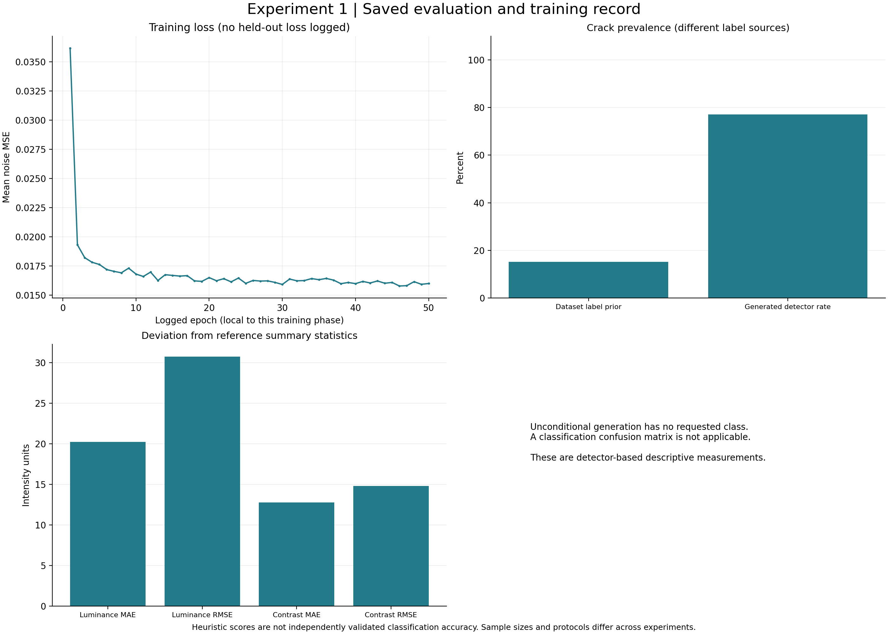
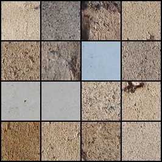

# Experiment 1 Research Report

## Unconditional concrete surface synthesis at 64 by 64 pixels

Revision: 2026-11-22. Study type: retrospective computational experiment. Historical checkpoint and saved evaluation; prospective validation is identified separately.

## Abstract

A compact unconditional DDPM provides a baseline for generating concrete surface patches without a crack-status input. Fifty logged training epochs end at noise-prediction MSE 0.015996. A later analysis of 1,000 saved outputs flags 771 images as cracked using a fixed image heuristic. This 77.10% detector prevalence is not an independently labeled crack rate and cannot be directly equated with the 15.13% cracked-label prevalence in the training manifest. The experiment demonstrates executable surface synthesis, while controlled crack generation and engineering validity remain unestablished.

## 1. Aim and research question

Can a compact unconditional diffusion model learn concrete surface appearance, and what does its output distribution reveal about the need for explicit crack conditioning?

A model trained on the mixed image distribution can synthesize concrete-like texture. Because no condition is supplied, this experiment cannot test requested crack-class compliance.

## 2. Technical stack and model specification

| Item | Specification and provenance |
| --- | --- |
| Image shape | 64 by 64 RGB |
| Denoiser | SmallUNet |
| Checkpoint tensor parameters | 3,258,115 |
| Image / conditioning channels | 3 RGB; no class input |
| Requested categories | 1 |
| Completed logged epochs | 50 |
| Final logged noise MSE | 0.015996154 |
| Minimum logged training MSE | 0.015782894 at local epoch 46 |
| Learning rate | 0.0002 (checkpoint optimizer) |
| Batch size provenance | Trainer default 64; historical command-line arguments not fully captured |
| Software | Python, PyTorch, torchvision, NumPy, Pillow, SciPy; Matplotlib and metric dependencies for evaluation |
| Optimizer | AdamW; beta values 0.9 and 0.999; weight decay 0.01 (saved optimizer where available, otherwise source defaults) |
| Gradient norm clipping | 1.0 in trainer source |
| Precision policy | Current historical trainer enables CUDA autocast and GradScaler; exact historical execution precision is not independently logged |
| Class dropout | Not used in the binary/unconditional source trainers |
| Sampling | 1,000-step ancestral DDPM for the shared pretrained reproduction path |
| Checkpoint selection | Released phase-final checkpoint; no independently held-out selection record |
| Augmentation | Image normalization; external data addition in Exp3, not a verified geometric augmentation benefit |

Epoch numbering in checkpoints is zero-based for Experiments 1–3 and one-based for the later phases; the training log is used to establish the completed phase length. A low training loss is not evidence of held-out generalization. Exact historical CUDA/PyTorch versions, CLI arguments and original peak resource measurements are not fully captured, so later environment checks are not substituted for historical runtime provenance.

## 3. Dataset composition and provenance

| Historical source | Training-manifest records |
| --- | --- |
| SDNET2018 | 50,482 |

| Historical label | Records |
| --- | --- |
| non_cracked | 42,846 |
| cracked | 7,636 |

Total historical training records: **50,482**. Source: [train.csv](../../datasets/exp1_exp2_sdnet_64/train.csv). These are processed patches, not counts of independent structures or photographs. Labels for the morphology/mechanism-inspired experiments are derived by image-geometry rules. The historical train/reference design and transfer ancestry do not establish independent holdout performance. Source image identities, alias grouping and current qualified manifests are discussed in Section 10.

Dataset references: SDNET2018 [R6].

## 4. Mathematical and implementation basis

For normalized image $x_0$, the implemented forward process uses $T=1000$ and a linear variance schedule from $10^{-4}$ to $0.02$. With $\alpha_t=1-\beta_t$ and $\bar{\alpha}_t=\prod_{s=1}^{t}\alpha_s$:

$$x_t=\sqrt{\bar{\alpha}_t}x_0+\sqrt{1-\bar{\alpha}_t}\epsilon,\qquad \epsilon\sim\mathcal{N}(0,I).$$

The denoiser minimizes noise-prediction mean squared error (the expression suppresses constant normalization by the number of image elements):

$$\mathcal{L}=\mathbb{E}_{x_0,t,\epsilon}\left[\lVert\epsilon-\epsilon_\theta(x_t,t,c)\rVert_2^2\right].$$

The condition $c$ is omitted for the unconditional model. This objective is implemented in the diffusion and training modules and follows the DDPM formulation [R1]. Training MSE is an optimization diagnostic, not a perceptual, topology or physical-validity score.

## 5. Experimental procedure

1. Index SDNET2018 and retain cracked/non-cracked and surface metadata; resize RGB patches to 64 by 64 and normalize image tensors.

2. Train SmallUNet to predict Gaussian noise using randomly sampled diffusion timesteps. Labels remain metadata and are not model inputs.

3. Save the 50-epoch checkpoint and generate the existing unconditional evaluation collection using the historical sampler.

4. Analyse all 1,000 saved images with the 64-pixel detector. Compute reference-summary deviations and a separate 160-real/160-generated feature diagnostic.

These steps reconstruct the procedure supported by saved artifacts and current source. Defaults are distinguished from observed checkpoint/log values; a missing historical execution configuration is not silently reconstructed as a verified run command.

## 6. Evaluation protocol and statistical interpretation

The primary morphology source is `src/evaluate_exp1_2_3_errors.py`. At 64 pixels it applies local-background subtraction with window 11, darkness threshold 13.5, minimum component area 6 pixels and nominal span threshold 11 pixels. The 128-pixel path additionally applies a 2 by 2 opening. Component counts, image-axis orientation and local contrast are detector outputs, not physical measurements.

The later fidelity diagnostic uses torchvision Inception-v3 with its classifier removed, 299-pixel resizing and ImageNet normalization. It selects training-manifest references: 160 real and 160 generated images for the stored score. KID uses 100 subsets of up to 128 feature vectors and a cubic polynomial kernel. This custom feature/preprocessing protocol is not interchangeable with a standard torch-fidelity run or the earlier torchmetrics feature-64 scores. The KID standard deviation describes subset variability, not a confidence interval over independent training runs.

Wilson 95% intervals summarize binomial counting uncertainty conditional on the saved generator and heuristic. They do not include training-seed variability, detector bias, source clustering or uncertainty about real mechanisms. Precision, recall and F1 computed against requested conditions quantify heuristic correspondence, not human-labeled classification accuracy. Pixel distances are in image coordinates; no physical millimetre scale is available.

For $k$ accepted outputs among $n$ requests, $\hat p=k/n$ and $z=1.95996$. The Wilson interval is

$$\frac{\hat p+z^2/(2n)\ \pm\ z\sqrt{\hat p(1-\hat p)/n+z^2/(4n^2)}}{1+z^2/n}.$$

## 7. Results

| Measurement | Saved result | Interpretation |
| --- | --- | --- |
| Generated heuristic crack detections | 771 / 1,000 (77.10%) | Detector prevalence; Wilson 95% interval 74.39–79.60% |
| Historical training label prior | 15.13% | Different label source; not a detector-calibrated reference |
| Mean continuity proxy | 0.116 | Largest-component statistic; depends on mask extraction |
| Generated / reference luminance mean | 147.8 / 163.67 | Intensity units, not physical surface reflectance |
| Generated / reference contrast summary | 23.15 / 11.07 | Image intensity standard deviation |
| Luminance deviation MAE / RMSE | 20.24 / 30.75 | Deviation from a reference summary; not a paired reconstruction |

### Protocol-qualified feature diagnostic

| Saved metric | Value |
| --- | --- |
| frechet_inception_distance | 128.886 |
| kernel_inception_distance_mean | 0.12193 |
| kernel_inception_distance_std | 0.00596 |
| evaluated_fake_samples | 160 |
| evaluated_real_samples | 160 |

FID and KID summarize feature distributions [R4, R5]; they do not certify crack presence or physical validity. Reference exposure, sample count, feature extraction and image preprocessing are part of the metric definition. Do not rank this value against experiments using another implementation or a different reference distribution.


Earlier report values belong to `src/evaluate_metrics.py`, which uses torchmetrics feature dimension 64 after resizing inputs to 64 pixels and index-paired AlexNet LPIPS [R11]. The later primary error-analysis score uses a different feature/preprocessing/reference path. Index-paired LPIPS on unpaired generated and real images is a distance diagnostic, not reconstruction fidelity. Earlier low FID values must not be combined with the later protocol as one trend. The pre-revision record is retained in the report archive.


Earlier report values, quoted as recorded rather than recomputed:

| Generated group | Feature-64 FID | Feature-64 KID mean | KID subset SD | Index-paired LPIPS |
| --- | --- | --- | --- | --- |
| Unconditional | 5.604571 | 3.419779 | 1.028021 | 0.548679 |

These values belong to the earlier technical record; original sample identities and execution configuration are incompletely captured. They are not substituted for the later primary diagnostic.


### Saved plots and generated examples



Figure interpretation: phase-local training loss, detector-defined rates and saved sample counts. This figure is a descriptive summary, not a controlled leaderboard or an independently labeled accuracy assessment.

The raw training log contains an additional numeric epoch-1 record and an embedded header. The current report uses the last numeric record for each epoch; the source log and all overwritten report versions are preserved.

### Archived illustrative outputs

The following saved illustrations retain their available filenames and request labels. Their membership in the quantified collection is not assumed without an original sampling manifest. They are not a blinded quality study, and their labels are not independent human judgments. The quantitative tables retain the complete stated evaluation denominators.



Generated concrete surface. Source illustration: `exp1_seed42.png`.

## 8. Observations and discussion

The fixed heuristic responds to local dark structures, including texture, shadows and aggregate boundaries. Its large prevalence relative to the dataset label prior therefore supports a detector/distribution mismatch concern, not a claim that the model generates five times as many genuine cracks. The low continuity proxy (0.116) and increased contrast relative to reference summaries are consistent with fragmented or over-detected dark texture. They do not locate a uniquely identified model failure without independently labeled generated images.

This experiment changes several design factors relative to other phases. Resolution, training images, label taxonomy, transfer ancestry, color processing, sampler and evaluator may differ. A before/after visual comparison is therefore hypothesis-generating; no causal attribution to a single architectural or conditioning change is made.

## 9. Assumptions and their consequences

| Assumption | Implementation or rationale | Consequence and validation status |
| --- | --- | --- |
| Image-level labels | SDNET labels describe patch status; they are not pixel masks. | Useful metadata, not supplied to the unconditional model. |
| Resolution | 64-pixel resizing retains enough texture for a baseline. | Thin fissures may disappear or merge; results do not establish topology preservation. |
| Prior comparison | Dataset labels and a generated-image heuristic measure comparable crack presence. | Unverified; their 15.13% and 77.10% rates use different label sources. |
| Reference statistics | Differences from reference mean luminance/contrast describe distributional deviation. | They are not paired reconstruction errors against a correct target image. |

All image-derived labels assume that visible dark geometry is informative about the intended visual attribute. Real masks, bounding boxes and class labels answer different annotation questions. Additional annotations or a mechanics-inspired name do not independently verify a failure mechanism.

## 10. Completed audits and prospective validation

The prospective **research_v5** manifests contain the following base partition counts. They were constructed after the historical training and do not retroactively make its checkpoints unseen-data models.

| Partition | Base records |
| --- | --- |
| train | 43,846 |
| validation | 6,606 |
| test | 5,640 |

The shared source audit covers 67,264 originals, with 65,866 distinct decoded RGB images and 1,398 extra exact decoded copies. The v4 perceptual screen found 386 cross-split candidates. V5 conservatively links all 1,111 candidate pairs, including within-split pairs, before assignment; the same pHash ≤3 and dHash ≤6 search then finds zero cross-split candidates. This limited, uncalibrated screen can miss crops, rotations, flips and larger edits. Source names and zero screened matches do not prove site or structure independence.


Scratch training, EMA selection on fixed-noise validation, provenance-checked generation and geometry/fidelity preflight are implemented for the new lineage. Their bounded smoke runs are infrastructure checks. Full clean multi-seed training, independently labeled generated images, external validation and downstream detector utility have not been established by the historical artifacts. A prepared campaign is not a completed experiment.

Computational sharing was tested in a fresh Windows/Python 3.10 CPU environment: the public weights were downloaded and verified and one image per experiment was generated without raw datasets. This confirms that inference can execute under that environment; it does not reproduce model training or validate image quality.

## 11. Sources of error and errors identified

| Identified issue | Correction or interpretation |
| --- | --- |
| Earlier FID 5.604571 presented alongside later FID 128.886 | Different feature dimensions, reference choices and preprocessing are used; keep both protocols separate. |
| Detector prevalence treated as genuine crack correctness | There is no requested class and no generated-image ground truth. |
| Repeated epoch 1 and an embedded CSV header | Use the last numeric record per epoch for the report; preserve the raw log. |

Further threats include segmentation sensitivity to texture and illumination; source overlap and patch clustering; heuristic circularity between curation and evaluation; small or unequal sample budgets; image-derived versus procedurally generated conditioning; reference preprocessing differences; and incomplete historical execution metadata. No structural safety, real crack width, downstream detection benefit, state-of-the-art performance or physical-cause accuracy is claimed from these measurements.

## 12. Conclusion

Experiment 1 establishes an unconditional synthesis baseline and its reproducible checkpoint. It does not establish a controllable crack generator. Its main research value is to motivate explicit conditioning and to expose how texture-sensitive detectors can distort crack-prevalence interpretation.

## 13. Reproducibility and artifact record

The released historical weights are used for inference; these commands do not start training. Run from the repository root with the documented dependencies and a fresh output directory.

```powershell
.\.venv\Scripts\python.exe pipeline/download_models.py
.\.venv\Scripts\python.exe pipeline/checkpoints.py verify
.\.venv\Scripts\python.exe pipeline/generate_cracks.py --experiment 1 --crack-type all --count 1 --seed 2026 --output-dir experiments/unconditional_ddpm/report_replication_seed2026
```

A fixed seed requires matching checkpoints, sampling settings, device and software for comparable execution; it does not guarantee cross-device pixel identity or exact replication of a historical example grid. Research training uses a separate scratch lineage and must not overwrite these final weights.

| Evidence | Artifact |
| --- | --- |
| Primary metric record | [EVALUATION_METRICS.json](../../experiments/unconditional_ddpm/EVALUATION_METRICS.json) |
| Training log | [training_loss.csv](../../experiments/unconditional_ddpm/logs/training_loss.csv) |
| Checkpoint SHA256 | 55fac363939c270cfb4d6e9c4e9dc645a1407b3749f9acb5611477d5f9dd2e9a |
| Input hashes and revision archive | [report_evidence.json](../../experiments/unconditional_ddpm/report_evidence.json) |
| Training source | [train.py](../../src/train.py) |
| Evaluation source | [evaluate_exp1_2_3_errors.py](../../src/evaluate_exp1_2_3_errors.py) |

Code is available in the [project repository](https://github.com/AlgoRubic/Crack-Image-Generation). The six historical checkpoints are distributed in the [versioned model release](https://github.com/AlgoRubic/Crack-Image-Generation/releases/tag/historical-models-v1), with a checksum manifest. Raw datasets are not included in that inference bundle. Dataset references identify their publishers, while local source inventories record observed archive hashes and outstanding identity/annotation limitations.


The machine-readable evidence file records input SHA256 values, checkpoint metadata, log handling and exact archived pre-revision sources. The historical reports remain recoverable and are superseded where their claims conflict with the corrected tables above. Original sampling files do not provide a complete checkpoint-hash chain for every historical evaluation image; association with the released phase checkpoint follows the available procedural record. Counts, Wilson intervals and derived matrix statistics are calculated from saved artifacts.

### Verified saved-image reproduction

On 22 November 2026, the morphology/spatial analysis was rerun on all saved evaluation images for this experiment in two fresh directories (`saved-analysis-20261122-v2` and `saved-analysis-20261122-v3`). All 27 compared numeric baseline fields matched with absolute tolerance 0.0001 and zero relative tolerance; the two fresh metric JSON records were identical in the same local environment. Per-image row counts, input/output SHA256 values and preservation of the original metrics were verified. Across all six experiments, each run analysed 4,992 images. Fidelity and the manually authored Exp4 comparison block were explicitly excluded, so this does not reproduce historical FID/KID, establish independent accuracy, or execute new sampling or training.

```powershell
.\.venv\Scripts\python.exe pipeline/reproduce_results.py --run-id my-exp1-review --experiments 1
```

The command refuses existing run folders and fails on missing historical inputs. Raw evaluation images and physics masks are retained locally and excluded from ordinary Git; Exp1–3 also require their recorded processed-image reference subset. A Git clone alone is sufficient for report evidence verification and published-weight inference, but does not contain every saved-image input. Read the [reproduction guide](../../docs/REPRODUCIBILITY.md) and [folder map](../../docs/PROJECT_STRUCTURE.md).

| Verified reproduction | Record |
| --- | --- |
| Summary | [saved_analysis_reproduction.json](../../experiments/saved_analysis_reproduction.json) |
| saved-analysis-20261122-v2 | [run_manifest.json](../../experiments/unconditional_ddpm/reproductions/saved-analysis-20261122-v2/run_manifest.json) |
| saved-analysis-20261122-v3 | [run_manifest.json](../../experiments/unconditional_ddpm/reproductions/saved-analysis-20261122-v3/run_manifest.json) |
## 14. References

[R1] Ho, Jain and Abbeel (2020). Denoising Diffusion Probabilistic Models. [Source](https://arxiv.org/abs/2006.11239)

[R4] Heusel et al. (2017). FID proposal in GANs Trained by a Two Time-Scale Update Rule Converge to a Local Nash Equilibrium. [Source](https://arxiv.org/abs/1706.08500)

[R5] Bińkowski et al. (2018). Demystifying MMD GANs; KID proposal. [Source](https://arxiv.org/abs/1801.01401)

[R6] SDNET2018 dataset and acquisition documentation. [Source](https://digitalcommons.usu.edu/all_datasets/48/)

[R11] Zhang et al. (2018). The Unreasonable Effectiveness of Deep Features as a Perceptual Metric; LPIPS. [Source](https://arxiv.org/abs/1801.03924)
